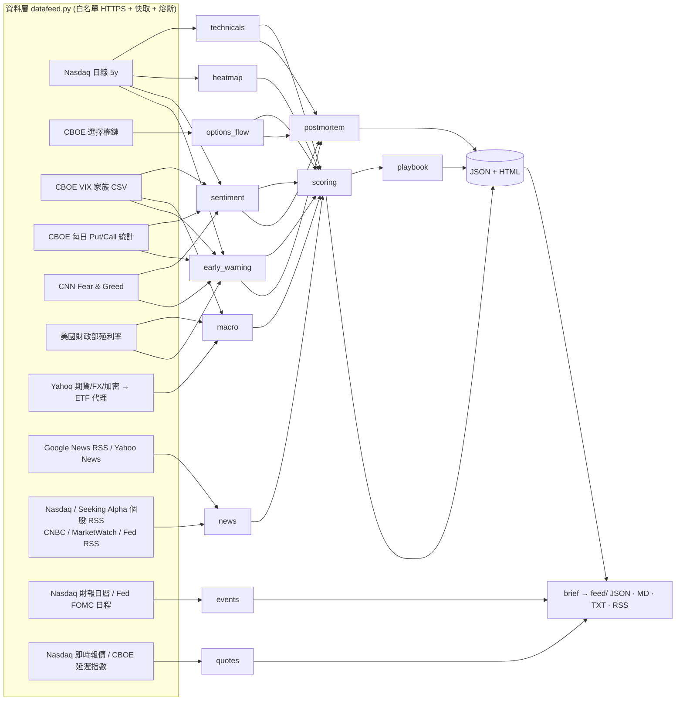

# SOXL Quant Playbook — 完整說明文件

> 一鍵產出 **SOXL（Direxion Daily Semiconductor Bull 3X）** 的投資決策儀表板：
> 期權籌碼 → 量價技術 → 市場情緒（CNN Fear & Greed、VIX 全家族、CBOE Put/Call、大戶期權流）→ 板塊廣度 → 宏觀跨資產 → 崩跌前兆系統 → 歷史同類情境機率 → −2~+2 評分表 → 下一步劇本 → 最近一次崩跌的復盤與教訓。
> 所有判讀文字、分數與價位**全部由資料即時計算**，沒有任何寫死的日期或價格，因此每天重跑都是正確的。
> 報告預設為 **新手模式**：第 0 區用一個大色塊（買進 / 觀望 / 賣出）、五格評級、買賣權重比與三問三答直接給答案；進階模式才展開全部分析。
> 另外提供 **新手版獨立頁面 `soxl_simple.html`**（一個畫面回答「今天該買還是該賣」）、**每日自動更新**（macOS launchd + GitHub Actions 雲端備援：美股收盤後自動抓所有 API、重算、重寫頁面、推播、`git push` 到 GitHub Pages，並累積每日評級紀錄與事後驗證），以及 **給 AI Agent（Muse 等）的吸收層**：一頁式簡報 `feed/latest.{md,json,txt}`、RSS、MCP server、多頻道推播（webhook / Google Chat / Slack / Telegram / LINE / email / agentapi）。

---

## 目錄

1. [快速開始](#1-快速開始)
   - 1.1 一次設定，之後每天自動更新
   - 1.2 讓 Muse / AI Agent 吸收（30 秒版）
2. [整體架構與資料流](#2-整體架構與資料流)
3. [資料來源、快取與安全](#3-資料來源快取與安全)
4. [新手 30 秒看懂：該買還是該賣？](#4-新手-30-秒看懂該買還是該賣)
   - 4.1 新手版獨立頁面 `soxl_simple.html`
   - 4.2 完整報告的第 0 區與六大區塊地圖
5. [各分析模組詳解](#5-各分析模組詳解)
   - 5.1 技術分析 `technicals.py`
   - 5.2 期權籌碼與預測 `options_flow.py`
   - 5.3 市場情緒 `sentiment.py`
   - 5.4 成分股熱力圖 `heatmap.py`
   - 5.5 宏觀跨資產相關性 `macro.py`
   - 5.6 崩跌前兆系統與事件研究 `early_warning.py`
   - 5.7 −2~+2 評分表 `scoring.py`
   - 5.8 下一步劇本 `playbook.py`
   - 5.9 崩跌復盤 `postmortem.py`
   - 5.10 新聞多空分類 `news.py`
   - 5.11 HTML 報告 `report_html.py` / `report_simple.py`
6. [輸出 JSON 結構](#6-輸出-json-結構)
7. [解讀指南：常見問題](#7-解讀指南常見問題)
8. [限制與注意事項](#8-限制與注意事項)
9. [維護與客製化](#9-維護與客製化)
10. [檔案結構](#10-檔案結構)
11. [每日自動更新機制詳解](#11-每日自動更新機制詳解)
12. [AI Agent / Muse 串接：feed、MCP、推播、GitHub Pages](#12-ai-agent--muse-串接feedmcp推播github-pages)

---

## 1. 快速開始

```bash
cd /Users/hsiaochieh/Documents/folder

# 完整流程：下載 (6 小時快取) → 分析 → 產出 JSON + 兩個 HTML（約 1–4 分鐘）
.venv/bin/python analyze_soxl.py

# 強制清快取重新下載
.venv/bin/python analyze_soxl.py --refresh

# 只產出 JSON、不產出 HTML
.venv/bin/python analyze_soxl.py --no-html

# 不連網，只用既有 JSON 重新產出兩個 HTML（改版型時很方便）
.venv/bin/python generate_html_report.py
```

輸出檔案（皆在本資料夾）：

| 檔案 | 說明 |
|---|---|
| **`soxl_simple.html`** | **新手版**：一個畫面回答「今天該買還是該賣」— 大色塊結論、評級儀表、買/觀望/賣比例、依你的狀況該怎麼做、建議倉位、三個關鍵價位、10 日劇本機率、前三大理由、120 天燈號圖與每日評級紀錄（無 JavaScript、每 30 分鐘自動重新載入） |
| `soxl_analysis_report.html`（＝ `index.html`） | 完整儀表板（新手 / 進階雙模式），用瀏覽器開啟即可（無外部資源、無需網路）；`index.html` 是同一份，給 GitHub Pages 當首頁 |
| `soxl_analysis_data.json` | 所有模組的結構化結果（約 500 KB），可供其他程式或 LLM 讀取 |
| **`feed/latest.md` / `latest.json` / `latest.txt`** | **給 AI Agent 的一頁式簡報**（Markdown / 結構化 JSON `soxl-quant-brief/2` / 手機短訊版）＋ `rss.xml`、`quotes.json`（即時報價快照）、`schema.json`、`index.json` 與 `YYYY-MM-DD.{json,md}` 歷史（120 天）。詳見 [第 12 節](#12-ai-agent--muse-串接feedmcp推播github-pages) 與 [AGENTS.md](AGENTS.md) |
| `history/verdicts.jsonl` | **每日評級紀錄**（每交易日一行：評級、綜合分、倉位上限、關鍵情緒/籌碼讀數，並自動回填之後 5 / 10 日實際報酬做事後驗證） |
| `history/snapshots/*.json.gz` | 每日完整 JSON 快照（gzip，保留 180 天，可回測或重現任一天的報告） |
| `logs/last_run.json`、`logs/auto_update.log` | 自動更新的最近結果（含推播與 git 發佈結果）與紀錄 |
| `.cache/` | 下載資料的快取（TTL 6 小時；`--refresh` 會清除） |

環境：Python 3.14（`.venv`），**只用標準函式庫**，沒有第三方套件（`requirements.txt` 為空是刻意的）。

### 1.1 一次設定，之後每天自動更新

```bash
# 安裝 macOS 使用者層級排程（不需 sudo）：預設 週二～週六 07:30（台北時間）= 美股週一～週五收盤後
.venv/bin/python auto_update.py install

# 查看排程狀態、上次結果、下次執行時間、推播與 git 發佈結果
.venv/bin/python auto_update.py status

# 立刻手動更新一次（抓 API → 評分 → HTML → feed → 推播 → git push；含重試）
.venv/bin/python auto_update.py run

# 其他：uninstall（移除排程）、notify-test（測試通知）、config（看 / 建立設定檔）
```

安裝後每次更新完成，macOS 會跳出通知「SOXL 2026-10-20 🔴 賣出 / 減碼｜$97.6（-1.06%）」加三行重點；打開 `soxl_simple.html` 就是最新結果（頁面頂端會顯示下次自動更新時間）。若 repo 已設定 GitHub 遠端與 SSH 金鑰，同一次更新會自動 `git push`，GitHub Pages 上的 `index.html` / `feed/` 也跟著更新。詳細機制（launchd、登入補跑、重試、盤中快照、日誌、疑難排解）見 [第 11 節](#11-每日自動更新機制詳解)。

> 第一次由排程執行時，macOS 可能跳出「python 想要存取你的「文件」資料夾」→ 請按「好」（只會問一次）。

### 1.2 讓 Muse / AI Agent 吸收（30 秒版）

```bash
# A. 直接抓（任何 agent、零安裝）
curl -s https://corleonis6422.github.io/stock-dashboard/feed/latest.md        # 一頁式簡報
curl -s https://corleonis6422.github.io/stock-dashboard/feed/latest.json      # 結構化資料

# B. 本機 MCP server（Antigravity / Gemini CLI / Claude / Cursor …）
.venv/bin/python auto_update.py mcp-install        # 寫進 ~/.gemini/config/mcp_config.json（先備份）
#    → agent 可呼叫 get_brief / get_quotes / get_news / get_events / get_latest(section) / refresh

# C. 更新完主動推給 Muse / 你
.venv/bin/python auto_update.py notify-config      # 建 notify_config.json（git 不追蹤、chmod 600）
#    填入 webhook URL（Muse inbox）/ Telegram / LINE / Slack / email / agentapi …，然後
.venv/bin/python auto_update.py push-test
```

欄位意義、新鮮度規則與 agent 該怎麼轉述，全部寫在 [AGENTS.md](AGENTS.md)。

---

## 2. 整體架構與資料流



執行順序由 `soxl_quant/pipeline.py` 控制（9 個步驟），**任何一個來源失敗都只會讓該模組降級，不會中斷其他分析**；失敗原因會寫進 JSON 的 `warnings` 與 HTML 頂端提示。
第 9 步除了寫出 JSON 與兩個 HTML（外加 `index.html`），還會 (a) 追加 `history/verdicts.jsonl` 的當日評級紀錄並回填舊紀錄的 5 / 10 日實際報酬、(b) 存 gzip 快照、(c) 讀取排程狀態放進頁面、(d) 抓未來事件與即時報價、產生 agent 簡報 `feed/`；所有檔案都是**原子寫入**（先寫暫存檔再 rename），排程中途失敗不會留下半份報告。

```mermaid
flowchart LR
  L[launchd 07:30 / 登入補跑] --> A[auto_update.py run --if-stale]
  GA[GitHub Actions 22:15 / 00:30 UTC<br/>只在 repo 資料落後時] --> A
  A -->|資料落後最近交易日| P[pipeline.run]
  A -->|已是最新| S[略過]
  P --> J[(JSON + 3 HTML)]
  P --> H[history/verdicts.jsonl + snapshots]
  P --> FD[feed/latest.json · md · txt · rss.xml]
  FD --> PUSH[推播 notify.py<br/>macOS · webhook(Muse) · Google Chat · Slack · Discord<br/>Telegram · LINE · email · agentapi · command]
  J & FD --> GIT[publish.py git commit + push]
  GIT --> PAGES[GitHub Pages<br/>index.html · feed/ · JSON]
  PAGES --> AG[任何 agent 用網址 pull]
  MCP[soxl_mcp.py MCP server] --> AG2[本機 agent 工具呼叫]
  P -->|失敗| R[等 10 / 30 分鐘重試，最多 3 次]
```

---

## 3. 資料來源、快取與安全

### 3.1 來源一覽（全部免費、免 API 金鑰）

| 資料 | 來源與端點 | 歷史長度 | 用途 |
|---|---|---|---|
| SOXL / SOXX / SOXS / SPY / QQQ / HYG / TLT / 16 檔成分股 日線 OHLCV | `api.nasdaq.com/api/quote/{SYM}/historical` | 5 年 | 技術、廣度、事件研究、資金流 |
| 當日（或最近一個交易日）K 線補齊 | `api.nasdaq.com/api/quote/{SYM}/chart` 的 1 分鐘序列（取 09:30–16:00 ET 算 OHLC）＋ `…/info` 的官方收盤與市場狀態 | 當日 | Nasdaq 官方日線**收盤後要數小時才公布**；排程在收盤後 1–3 小時跑時，用這兩個端點補上當天的 K 線（標示「收盤即時報價補齊」），隔天自動換回官方日線。盤中執行則成為「盤中快照」 |
| **即時報價快照**（SOXL / SOXS / SOXX / SPY / QQQ、NVDA 等 7 檔龍頭、VIX / VIX3M / VIX9D / SKEW） | `api.nasdaq.com/api/quote/{SYM}/info`（近即時，含盤後）＋ `cdn.cboe.com/api/global/delayed_quotes/quotes/_{IDX}.json`（延遲 15 分） | 當下 | `feed/quotes.json`、MCP `get_quotes`、`auto_update.py quotes` |
| SOXL / SOXX / SOXS 選擇權鏈（含 bid/ask/last/IV/OI/Volume/Greeks/theo/change） | `cdn.cboe.com/api/global/delayed_quotes/options/{SYM}.json` | 即時（延遲報價） | 期權籌碼、GEX、大戶流、預期波動 |
| VIX / VIX9D / VIX3M / VIX6M / VIX1D / VVIX / SKEW | `cdn.cboe.com/api/global/us_indices/daily_prices/{NAME}_History.csv` | 完整歷史 | VIX 家族、期限結構、前兆訊號、宏觀相關 |
| 全市場 Put/Call（Total / Index / Equity / ETP / SPX / VIX） | `cdn.cboe.com/data/us/options/market_statistics/daily/{YYYY-MM-DD}_daily_options` | 近 60 日 | 情緒、前兆訊號 |
| CNN Fear & Greed（綜合 + 7 子指標 + 1 年歷史） | `production.dataviz.cnn.io/index/fearandgreed/graphdata`（需瀏覽器 Referer） | 250 日 | 情緒、前兆訊號、同類情境 |
| 美國公債殖利率曲線（2Y/5Y/10Y/20Y/30Y） | `home.treasury.gov/...daily-treasury-rates.csv/{year}/all` | 3–4 年 | 宏觀、前兆訊號 |
| Brent / 美元指數 / 黃金 / 銅 / BTC / MOVE | Yahoo Finance v8 chart；**限流時自動改用 ETF 代理**：BNO / UUP / GLD / CPER / IBIT（Nasdaq） | 1–2 年 | 宏觀相關、跨資產風險溫度計 |
| 新聞 | Yahoo Finance search API + **Google News RSS** + **Nasdaq 個股 RSS**（SOXL / NVDA / AVGO / AMD / MU / TSM / AMAT / LRCX）+ **Seeking Alpha 個股 RSS** + **CNBC Markets / Tech、MarketWatch Pulse / Top、Fed 新聞稿 RSS**（市場型 RSS 以半導體 / 宏觀關鍵字過濾） | 近 2 週 | 利多/利空分類、簡報頭條 |
| **未來事件** | FOMC：`federalreserve.gov/monetarypolicy/fomccalendars.htm`（解析失敗用內建 2026 日程）；成分股財報：`api.nasdaq.com/api/calendar/earnings?date=`（掃未來 10 個交易日）；週 / 月選擇權到期與 NYSE 假日由程式推算 | 未來 14 天 | 簡報「近期事件」、推播風險提醒 |

### 3.2 快取與限流

- 每個請求的結果以 JSON 存在 `.cache/`（鍵 = 來源 + 參數的 SHA-256），TTL 6 小時（新聞 30 分鐘、CBOE 每日統計 7 天）。
- 每個主機有最小請求間隔（Yahoo 2.2 秒、Nasdaq 0.9 秒）與指數退避重試。
- **熔斷器**：Yahoo 回 HTTP 429 兩次後，該主機在 10 分鐘內直接跳過，避免整條流程卡住；此時 Brent 等指標自動換 ETF 代理，報告會標示「(BNO ETF 代理)」。
- 當日 K 線補齊（`fetch_nasdaq_latest_session`）只快取 10 分鐘，而且只在官方日線落後「最近一個已開盤的交易日」時才會呼叫，不會增加平常的請求量。

### 3.3 安全設計

- 所有外連限定在白名單主機（`datafeed.ALLOWED_HOSTS`），符號與日期參數都經正規表達式驗證。
- HTML 內所有插值經 `html.escape()`；頁面帶嚴格 `Content-Security-Policy`（`default-src 'none'`、script 僅允許 nonce），JS 只操作 `classList` / `textContent`（無 `innerHTML`、無外部資源）。
- 新手版 `soxl_simple.html` **完全沒有 JavaScript**（CSP `script-src 'none'`、`frame-ancestors 'none'`）。
- 排程模組 `scheduler.py` 只呼叫固定路徑的 `/bin/launchctl`、`/usr/bin/osascript`、`/usr/bin/open`，且參數形狀固定；設定檔裡的時間 / 星期 / label / 音效名稱都先經正規表達式驗證；通知文字以 **argv** 傳給 AppleScript，不做字串拼接，避免注入。

---

## 4. 新手 30 秒看懂：該買還是該賣？

### 4.1 新手版獨立頁面 `soxl_simple.html`

給完全不想看指標的人：**一個畫面、一個答案**。由上而下只有這幾塊，每塊都是白話：

| 區塊 | 內容 | 怎麼讀 |
|---|---|---|
| 頂端狀態列 | 資料日期（官方日線 / 收盤即時報價補齊 / 盤中快照）、報告產生時間、**是否已啟用自動更新與下次時間** | 看到「⏸ 尚未啟用」就執行 `auto_update.py install` |
| 🔴🟡🟢 結論大色塊 | 強力賣出 / 賣出・減碼 / 觀望 / 分批買進 / 買進・持有 + 一句話 + 現價、綜合分、信心、底部檢核 x/8 | 顏色就是答案 |
| 📊 評級儀表 | TradingView 式五格 + 「賣出 / 觀望 / 買進」權重條 + 偏空 / 中性 / 偏多項數 | 紅色過半＝不要買；綠色過半＋檢核 ≥6 才是買點 |
| 🙋 我該怎麼做 | 三張卡：還沒買 / 已持有或套牢 / 什麼時候才能買 | 選自己的狀況那張看 |
| 🎚️ 現在最多放多少 | 0 / 10 / 25 / 50 / 100%（佔你原本打算投入 SOXL 的最大金額） | 永遠不要超過總資產 10–15% |
| 📍 三個價位 | 跌破就要跑（停損）／第一道關卡（反彈減碼點）／站上才算轉強，各附距現價 % | 進場前先決定停損 |
| 🎲 未來 10 天 | 反彈 ≥10% / 區間 / 續跌 ≥10% 三條機率條（歷史同類情境統計） | 用來決定倉位，不是預言 |
| 🤔 為什麼 | 看空 / 看多各前三大理由（指標、實測值、白話原因） | 想知道「為什麼紅」就看這裡 |
| 🚦 過去 120 天燈號 | 背景色＝**只看價格**的燈號（20/50/200MA、MACD、RSI、SuperTrend 投票），可回溯；圓點＝完整模型每日評級，從啟用自動更新那天起每天累積 | 一眼看出燈號何時由綠轉紅、紅燈持續幾天 |
| 📅 每日評級紀錄 + 🧪 事後驗證 | 最近 21 天的評級小方塊；累積 ≥3 筆回填後顯示「當日評級 vs 之後 5 / 10 天實際漲跌」表與偏空 / 偏多評級後的平均報酬 | 自己判斷這套評分準不準 |
| 👀 這週盯三件事 / 🧯 新手三鐵律 / 📖 名詞小抄 | 觀察清單前 3 條、3x 槓桿風險提醒、15 個名詞 | — |

頁面每 30 分鐘自動重新載入（`<meta http-equiv="refresh">`），搭配自動更新就是「一直開著的看板」；右上角可跳到完整報告。

### 4.2 完整報告的第 0 區與六大區塊地圖

打開 `soxl_analysis_report.html`，預設是 **新手模式**，只顯示第 0、1、3 區；右上角「切換到進階模式」才會展開完整評分表、情緒 / 期權預測與崩跌復盤。

第 0 區「新手一頁看懂」的版型參考了 Reddit DD 文與主流看盤網站的呈現方式：

| 元素 | 長什麼樣 | 借鏡自 | 怎麼讀 |
|---|---|---|---|
| **結論大方塊** | 一個大色塊：🔴🔴 強力賣出 / 🔴 賣出・減碼 / 🟡 觀望 / 🟢 分批買進 / 🟢🟢 買進・持有 + 一句話 + 信心等級 | WSB DD 文的標題 + 結論 | 顏色就是答案；「信心」＝ 7 個維度裡有幾成同方向（≥70% 高、45–70% 中、<45% 低） |
| **TL;DR 三行** | 結論與權重比 → 最大空方 / 多方理由 → 守哪裡、看哪裡、反彈與續跌機率 | r/wallstreetbets、r/stocks 的 TL;DR 慣例 | 只看這三行也能做決定 |
| **技術評級儀表** | 五格橫條：強力賣出 ─ 賣出 ─ 中立 ─ 買進 ─ 強力買進，白色箭頭指出目前位置；下方寫「偏空 N 項・中性 N 項・偏多 N 項」 | TradingView Technical Rating | 綜合評分 −2~+2 線性換算：≤−1.25 強力賣出、−1.25~−0.35 賣出、±0.35 中立、0.35~1.25 買進、≥1.25 強力買進 |
| **買進 / 觀望 / 賣出 權重比** | 紅灰綠三色堆疊條，例如「賣出 61% ｜ 觀望 23% ｜ 買進 16%」+ 買賣權重比 | Yahoo / MarketBeat 的分析師共識條、StockTwits 多空比 | 把 22 項指標的「權重」依分數正負分三堆；買/賣權重比 >1.5 偏多、<0.67 偏空 |
| **三問三答** | ❓ 沒部位能買嗎 / ❓ 已持有怎麼辦 / ❓ 什麼時候才能買 | 新手最常在 Reddit 問的三個問題 | 每題都是一句可執行的指令，含具體價位與部位比例；第三題列出檢核表「最先要成立的 3 件事」 |
| **建議曝險上限** | 油量條 0% / 10% / 25% / 50% / 100% | r/LETFs 常見的部位紀律 | 佔「你原本打算投入 SOXL 的最大金額」：檢核表 <3 項 → 0–10%（只准反彈單）、3–5 項 → 25%、6–7 項 → 50%、8 項且偏多 → 100% |
| **多方論點 vs 空方論點** | 左右兩欄各 4 條，附權重分數 | DD 文的 Bull Case / Bear Case | 從評分表自動挑出「分數 × 權重」最大的正負因子，不用自己翻 22 項 |
| **交易計畫卡** | 進場條件 / 停損 / 目標 / 報酬風險比 / 部位上限 | DD 文的 Positions / Plan | 進場、停損、目標全部來自價位階梯與期權 1σ，數字會隨資料更新 |
| **本週觀察清單** | 5 條：價格、期權到期與 Max Pain、情緒、板塊廣度、前兆分數 | r/options 的 weekly watch | 這些數字變了就該重跑、重看 |
| **名詞小抄** | 15 個名詞的一句話解釋 | — | 看不懂就點開 |

> 結論大方塊的判定 = 五格評級 + 檢核表成立數：例如評級「買進」但檢核表 <5 項會降為「觀望偏多（等確認）」；評級「賣出」且檢核表 <3 項會寫「現在不是買點」。所以**顏色不會只因為一個指標翻轉**。

### 報告六大區塊地圖

| 區塊 | 模式 | 內容 | 先看什麼 |
|---|---|---|---|
| **0. 新手一頁看懂** | 新手 | 結論大方塊、TL;DR、五格評級、買/觀望/賣權重比、三問三答、曝險上限、多空論點、交易計畫、觀察清單、名詞小抄 | 顏色 + 三問三答 |
| **1. 現在該怎麼做** | 新手 | 綜合評分（趨勢面 / 逆勢面）、5 個儀表（市場脈搏、Fear & Greed、崩跌前兆、VIX、大戶方向）、價位階梯、三劇本與機率、重返多頭檢核表 | 檢核表幾項成立 |
| **2. 評分表** | 進階 | 7 維度 ~22 項 −2~+2，每項附實測值、評分標準、白話意義；可依加分/中性/扣分篩選 | 哪個維度拖累、哪個維度支撐 |
| **3. 圖表** | 新手 | 日 K + 20/50/200MA + 布林 + 關鍵價位（Fib、Put/Call 牆、Gamma 翻正位）、成交量、MACD、KD；崩跌前兆分數疊圖；期權牆；成分股熱力圖（1D/5D/20D 切換）；大戶大單表 | 價格相對關鍵價位的位置 |
| **4. 情緒 & 期權預測** | 進階 | F&G 一年走勢與 7 子指標、市場脈搏組成、VIX 家族表、Put/Call 表、期權隱含預期波動（週/月/季）、IV 機率錐、月選價位機率、宏觀相關表、跨資產溫度計 | 市場「定價」的波動範圍 vs 自己的預期 |
| **5. 崩跌復盤與教訓** | 進階 | 逐日時間軸、21 項前兆在高點前後的狀態、歷史同類情境報酬分佈、前兆分數實證（事件研究）、教訓與規則、每日利多/利空新聞 | 教訓的「規則」欄 |

---

## 5. 各分析模組詳解

### 5.1 技術分析 `technicals.py`

輸入：SOXL 5 年日線。輸出：指標數值、11 列技術指標表（每列含讀數 / 訊號 / −2~+2 分數 / 白話說明）、120 日圖表序列。

| 指標 | 參數 | 訊號 / 評分邏輯（摘要） |
|---|---|---|
| 均線結構 | EMA5/10/20、SMA20/50/100/200 | 價 > 20 > 50 > 200 ⇒ +2 完全多頭；價 < 20 但 > 50 & 200 ⇒ +1 多頭回檔；價 < 50 但 > 200 ⇒ −1 中期修正；價 < 200 ⇒ −2（50 < 200 為空頭排列） |
| MACD | 12, 26, 9 | 零軸上柱體擴張 +2 / 收斂 +1；零軸下柱體擴張 −2 / 收斂 −1；金叉 +1、死叉 −1 |
| KD / KDJ | 9, 3, 3（亞洲式 1/3 平滑） | K<20 且（D<25 或 J<0）為超賣區：勾頭向上 +1、否則 0（低檔鈍化）；K、D >80 為超買區；其餘看金叉/死叉 |
| 慢速 KD | 14, 3, 3 | 僅顯示低檔 / 中軸 / 高檔 |
| RSI | 6 / 14 / 24 + StochRSI(14) | RSI14 <30 超賣（RSI6 <20 再 +1）；>70 超買；14、24 皆 ≥50 ⇒ +1；皆 <50 ⇒ −1 |
| ADX / DMI | 14 | +DI > −DI：ADX ≥25 ⇒ +1（強勢多頭）否則 0；−DI > +DI：ADX ≥35 ⇒ −2、≥25 ⇒ −1、否則 0 |
| Supertrend / SAR | (10, 3) / (0.02, 0.2) | 價在線上 +1、線下 −1 |
| 一目均衡表 | 9, 26, 52 | 雲上且 > 基準線 +2；雲上但 < 基準線 +1；雲中 0；雲下 −2 |
| 布林通道 | 20, 2σ | %B <0 極端超賣 0；<0.2 貼近下軌 0；>1 突破上軌 +1；≥0.5 +1；<0.5 −1 |
| 斐波那契 | 戰術波段 = 最近 40 根 K 的最高/最低；大格局波段 = 最近 160 根 | 自動判斷上升波（回撤支撐）或下降波（反彈反壓）；依價格所在區間給 −2~+2 |
| Williams %R / CCI / ROC | 14 / 20 / 12 | %R < −80 或 CCI < −100 ⇒ 超賣（0 分）；ROC < −10% ⇒ −1、> +10% ⇒ +1 |

另外計算：ATR(14)、20 日實現波動率（年化）、52 週高低與回撤、距各均線百分比、連跌天數、20 日上漲/下跌量能比與放量吸籌/派發日數、20 日 VWAP、半年 VPVR（126 日、24 格；POC / 價值區 70% VAH–VAL）、CMF(20)、OBV、MFI(14)、古典樞軸點。

### 5.2 期權籌碼與預測 `options_flow.py`

輸入：CBOE SOXL 完整鏈（約 3,000 檔），另抓 SOXX、SOXS 做交叉驗證。

- **基本統計**：Call/Put 成交量比與 Put/Call、未平倉比、權利金成交額（Volume × Mid × 100）、各到期日的 P/C、Max Pain、ATM IV。
- **淨 Gamma 曝險（GEX）**：每檔 `±Gamma × OI × 100 × Spot² × 1%`（Call 為正、Put 為負，即造市商做多 Call、做空 Put 的標準假設），加總為總 GEX（百萬美元）。負 GEX = 造市商順勢對沖、放大波動。
- **Gamma 翻正位**：把每檔選擇權用 Black-Scholes 在 55%~145% 現價的網格上重新計算 Gamma，找出總 GEX 由負轉正、距現價最近的價位。站上翻正位後造市商改為逆勢對沖（壓抑波動）。
- **Call / Put 牆**：現價上方 Call OI 最大的履約價 / 下方 Put OI 最大的履約價（視窗為現價 ±45%）。
- **Max Pain**：近 3 個到期日合併，以及月選單獨計算。
- **25Δ 偏度**：7–45 DTE 內 |Delta| 0.18–0.35 的 Put IV − Call IV。
- **大戶（Whale）vs 散戶流**：
  - 大戶定義：單檔**當日權利金 ≥ $25 萬**，或 **成交 ≥ 1,500 口且權利金 ≥ $10 萬**，且 **Vol/OI ≥ 0.4**（新倉而非平舊倉）。
  - 成交方向推斷：最後成交價 ≥ 賣價 ⇒ 買方主動（buy）；≤ 買價 ⇒ 賣方主動（sell）；落在價差內則看該檔**當日價格變化**：上漲 ⇒ 偏買（權重 0.7）、下跌 ⇒ 偏賣（0.3）、持平 0.5。
  - 看多金額 = 買 Call + 賣 Put；看空金額 = 買 Put + 賣 Call；**淨方向分數 = (多 − 空) / (多 + 空)**，介於 −1~+1。
  - 散戶代理：成交 ≤ 50 口的小單，計算其 Call/Put 權利金比。
- **期權隱含預測**：
  - 預期波動 = 最近週選（≥3 DTE）、月選（≥15 DTE，最接近 30）、季選（≥60 DTE）的 **ATM 跨式價格**（找不到有效報價時改用 theo）。
  - IV 機率錐：用月選 ATM IV，對 1 週 / 2 週 / 1 個月 / 3 個月給 ±1σ（68%）與 ±2σ（95%）區間（對數常態）。
  - 價位機率：月選到期時高於/低於 70%~150% 現價各檔位的風險中性機率 `N(d2)`，以及「期間觸及」≈ 2 × 到期機率。
  - IV 期限結構：近月（≤10 DTE）vs 遠月（60–120 DTE）ATM IV，近 > 遠 ×1.05 ⇒ 倒掛（恐慌定價）。

### 5.3 市場情緒 `sentiment.py`

| 指標 | 計算 / 判讀 |
|---|---|
| **CNN Fear & Greed** | 綜合分數（0 極度恐懼 → 100 極度貪婪）、前日 / 一週 / 一月 / 一年前、1 年歷史；7 子指標：S&P 動能（vs 125DMA）、52 週新高新低、上漲/下跌成交量、5 日 Put/Call、VIX（vs 50DMA）、垃圾債需求、避險需求。<25 極度恐懼、25–45 恐懼、45–55 中性、55–75 貪婪、>75 極度貪婪 |
| **VIX 家族** | VIX、VIX9D、VIX3M、VIX6M、VIX1D、VVIX、SKEW；VIX 50 日均線乖離、1 年百分位、5 日變化、近 5 日盤中高。水位分級：<13 極度自滿、13–16 低波、16–20 溫和警戒、20–25 恐慌升溫、25–35 高度恐慌、>35 極端 |
| **期限結構** | VIX/VIX3M：<0.95 正價差（常態）、0.95–1.05 走平（回檔前常見的警訊區）、≥1.05 倒掛（恐慌高峰、常伴短線底）；另有 VIX9D/VIX3M |
| **VVIX / SKEW** | VVIX >110 壓力、95–110 偏高；SKEW >150 極高尾部避險、135–150 偏高 |
| **CBOE Put/Call** | Total / Equity / Index / SPX / VIX，單日與 5、20 日均；個股 P/C ≥0.85 散戶恐慌、0.70–0.85 偏防禦、0.55–0.70 中性、<0.55 自滿 |
| **SOXL / SOXS 資金流** | 兩者成交金額比 vs 20 日均：>1.3× 且價跌 ⇒ 散戶接刀狂潮；<0.7× ⇒ 放空/避險升溫 |
| **跨資產溫度計** | HYG、TLT、美元、銅、黃金、BTC、MOVE 的 5 / 20 日變化與 1 年百分位；衍生 HYG−TLT 20 日差、銅金比 20 日變化 |
| **市場脈搏 Market Pulse** | 0 恐懼 → 100 貪婪的加權平均（相對權重）：F&G 30、VIX 水位 20（分段映射 VIX 12→95 … 40→0）、期限結構 10、個股 P/C 5 日 15、HYG−TLT 10、SKEW 5、VVIX 5、銅金比 5、SOXL/SOXS 流 5；缺資料的項目自動剔除並重新正規化 |

### 5.4 成分股熱力圖 `heatmap.py`

16 檔核心持股（NVDA 10.2%、AVGO 9.8%、AMD 8.4%、MU 7.6%、QCOM 6.8%、TXN 6.5%、AMAT 6.1%、LRCX 5.6%、KLAC 5.2%、INTC 4.8%、ADI 4.6%、MRVL 4.4%、NXPI 4.1%、MPWR 3.8%、ON 3.5%、TER 3.2%，權重為近似值）。每檔計算 1/5/20/60 日報酬、距 52 週高點、RVOL、RSI(14)、是否站上 20/50/200MA、與 SOXL 的 20 日報酬相關。彙總：站上 20/50/200MA 比例、RSI<30 比例、1D/5D 上漲家數比例、加權動能、子板塊（AI GPU、ASIC 網通、記憶體、設備、類比、車用…）表現。

### 5.5 宏觀跨資產相關性 `macro.py`

- 資產：10Y（^TNX）、30Y（^TYX）、30Y−10Y 利差、Brent、VIX（CBOE 官方）、美元、HYG、黃金、銅、BTC（後五項可選，缺少時自動略過）。
- 視窗 20 / 60 / 120 / 250 日，各算 **日報酬相關**（方向同步性）與 **價格水位相關**（趨勢同步性）；完整相關矩陣（20D、60D）。
- Beta：VIX 每 +1% 對 SOXL（20 日）、油價每 +1%（20 日）、10Y / 30Y 每 +10 bps（120 日）。
- 殖利率分級：10Y >5.2% 極端高檔、4.6–5.2 高檔、4.0–4.6 中性、<4.0 寬鬆；30Y >5.5% 多年高點區。
- 滾動 20 日相關序列（120 日）供日後畫圖。

### 5.6 崩跌前兆系統與事件研究 `early_warning.py`

**目的**：把常見的「頂部型崩跌」前兆量化成每日 0–100 的分數，並用 SOXL 自己的歷史驗證它有沒有用。

**21 項訊號**（每項 0~1 分，括號為權重）：

| 家族 | 訊號 | 觸發方式（線性漸進，達上限 = 1） |
|---|---|---|
| A 過熱 | 距 200MA 乖離 (8) | +25% → 0，+60% → 1 |
| | 距 20MA 乖離 (6) | +8% → 0，+20% → 1 |
| | 20 日拋物線漲幅 (8) | +20% → 0，+60% → 1 |
| | RSI(14) 超買 (4) | 65 → 0，80 → 1 |
| | 布林帶寬 1 年百分位 (4) | 80% → 0，100% → 1 |
| B 動能 | MACD 柱連 3 日收斂且 <60% 近高 (6) | 二元 |
| | KD 高檔死叉 D>70（近 3 日）(6) | 二元 |
| | 首次跌破 20MA（前 10 日皆在上方）(8) | 二元（持續 3 日） |
| | RSI 頂背離（價創 20 日高、RSI 低於前高 4 點以上）(5) | 二元 |
| | 15 日內放量派發日數 (5) | 2 天 → 0，6 天 → 1 |
| C 波動 | VIX/VIX3M 期限結構 (6) | 0.88 → 0，1.00 → 1 |
| | VIX 從 ≤18 低檔 5 日急升 (5) | +10% → 0，+40% → 1 |
| | VVIX (3) | 95 → 0，115 → 1 |
| | SKEW (3) | 140 → 0，165 → 1 |
| | VIX9D/VIX 倒掛 (3) | 0.98 → 0，1.08 → 1 |
| D 宏觀 | 10Y 20 日急升且 ≥4.5%，或 30Y 處 1 年 97 百分位 (5) | +10 bps → 0，+40 bps → 1 |
| | 信用背離：HYG 10 日下跌而 SPY 未跌 (5) | −0.5% → 0，−2% → 1 |
| E 情緒 | CNN F&G 貪婪 (2) | 60 → 0，85 → 1 |
| | F&G 5 日內從 ≥50 急跌 (2) | −8 分 → 0，−23 分 → 1 |
| | 個股 P/C 5 日均自滿 (3) | 0.60 → 0，0.45 → 1 |
| | SOXL/SOXS 資金比暴增且價跌 (3) | 1.1× → 0，1.5× → 1 |

- **原始分數** = 加權平均 × 100（缺資料的訊號不計入分母）。
- **校準**：原始分數換算成 **2021 年以來的歷史百分位**（排除最近 60 日，避免最新事件改變自己的尺度）。分區：<60 低風險、60–80 注意、≥80 警戒（建議減碼 3x 部位）。價已在 200MA 之下時，分數代表「壓力持續度」而非新頂部前兆（報告會註明）。
- **事件研究**（驗證）：
  - 事件 = 之後 5 個交易日內最低收盤 ≤ −20%；相隔 ≥10 日視為獨立事件；依事件起點是否在 200MA 之上分為「頂部型」與「下跌延續型」。
  - 指標：逐日精準度 / 召回 / 基準率 / 提升倍數（門檻 80、90）；頂部型事件中事前 5 日內分數 ≥80 的比例；「警報段」（連續 ≥80 的日子，間隔 ≥5 日分段）在 15 日內是否真的發生事件；依分數分組（0–60 / 60–80 / 80–90 / 90–100）的後 5 日跌 ≥10% / ≥20% 機率。
- **歷史同類情境（Analogs）**：9 種條件（噴出後首根長黑、過熱後首次破 20MA、KD 高檔死叉當日大跌、5 日跌 ≥20%、10 日跌 ≥30%、RSI<25、52 週回撤 ≥40% 且 VIX ≥20、跌破 200MA >10%、F&G <20），各算 5 / 10 / 20 / 60 日後報酬的中位數、四分位、上漲機率、≥+10% 與 ≤−10% 的機率、最佳/最差；樣本 <8 日標示「樣本不足」。
- **高點檢核表**：最近 30 根 K 的最高收盤為「高點」，列出高點前 2 日～後 6 日每項訊號的值與首次觸發日。

### 5.7 −2~+2 評分表 `scoring.py`

每項因子附：實測值、權重、評分標準、白話意義，以及 **類型**：`trend`（順勢）、`contrarian`（逆勢/情緒極端）、`flow`（籌碼）。

| 維度 | 因子（權重） |
|---|---|
| 1. 期權籌碼 | Call/Put 成交量比 (4)、淨 GEX & Gamma 翻正位 (5)、25Δ IV 偏度 (3)、大戶淨方向 (4)、Max Pain 與牆位置 (4) |
| 2. 量能結構 | 20 日上漲/下跌量能比 (5)、CMF/OBV/MFI (4)、VWAP/POC/價值區位階 (5) |
| 3. 技術趨勢 | 均線結構 (8)、MACD (5)、KD (4, 逆勢)、RSI (4, 逆勢)、斐波那契/一目/Supertrend 共振 (5) |
| 4. 板塊廣度 | 站上 20/50/200MA 比例 (6)、權值股加權動能 (4) |
| 5. 宏觀 | 10Y/30Y 殖利率 (4)、原油 (3；代理時改用 20 日變化)、VIX 水位 (3) |
| 6. 市場情緒 | CNN F&G (4, 逆勢)、VIX 期限結構 (3, 逆勢)、CBOE 個股 P/C (3, 逆勢)、SOXL/SOXS 資金流 (2, 逆勢)、崩跌前兆分數 (3) |
| 7. 消息面 | 近 7 日利多/利空新聞比 (6) |

- **綜合分數** = 加權平均（−2~+2）；≥1.25 強勢看多、0.35~1.25 偏多、±0.35 中性、−1.25~−0.35 偏空、≤−1.25 強勢看空。
- 另給 **趨勢面子分數** 與 **逆勢面子分數**，並據此判定格局，例如「空頭趨勢 + 情緒極端 → 超賣反彈格局：只做短線反彈、不做趨勢多單」或「多頭 + 情緒過熱 → 漲多拉回風險區」。
- **新手用的彙總輸出**（供第 0 區使用）：
  - `rating_5` / `rating_label`：五格評級 1 強力賣出 → 5 強力買進（門檻同上）；`rating_pos` 為儀表位置（0–100）。
  - `consensus`：把 22 項的**權重**依分數正負分成 買進 / 觀望 / 賣出 三堆的百分比（`buy_pct` / `hold_pct` / `sell_pct`）、各堆項數、+2 與 −2 的項數、買賣權重比。
  - `confidence` / `agreement_pct`：7 個維度平均分與綜合方向一致的比例，≥70% 高、45–70% 中、<45% 低。

### 5.8 下一步劇本 `playbook.py`

- **標題結論**：由趨勢面 / 逆勢面子分數的組合產生。
- **價位階梯**：自動收集所有有意義的價位（EMA5/10、20/50/200MA、VWAP、POC、價值區下緣、戰術斐波那契、Gamma 翻正位、Call/Put 牆、Max Pain、週/月選 ±1σ、近 10 日高低、布林下軌、前波恐慌低點、52 週低），依現價分為反壓/支撐，相近（1.2% 內）的合併，各取最近 6 個。
- **三劇本與機率**：從歷史同類情境中選「今日成立、樣本 ≥8」且最貼切的條件（優先序：10 日跌 ≥30% → 5 日跌 ≥20% → RSI<25 → 52 週回撤 ≥40% 且 VIX ≥20 → 跌破 200MA → F&G<20 → 全部交易日），用其 **10 日後 ≥+10% / ≤−10% 的歷史比例** 作為 A（反彈）/ C（續跌）機率，其餘為 B（區間）。觸發與目標價位直接取自價位階梯與期權 1σ。
- **重返多頭檢核表**（8 項）：站回 20MA、前兆分數 <60、VIX/VIX3M <0.92、成分股 >40% 站回月線、大戶淨方向 ≥0、MACD 柱翻正、F&G >25 且回升、20 日量能比 >1。≥6 項可分批建立趨勢部位；3–5 項只做小量反彈單；<3 項觀望。
- **新手區塊 `beginner`**（第 0 區的全部內容）：
  - `verdict` / `color` / `emoji` / `one_liner`：由五格評級 × 檢核表成立數決定（評級買進但檢核 <5 → 「觀望偏多 (等確認)」；評級賣出且檢核 <3 → 「現在不是買點」；趨勢空 + 逆勢多 → 加註「只適合小量短線」）。
  - `q_no_position` / `q_holder` / `q_when`：三問三答，價位取自價位階梯（停損 = 第一道支撐、目標 = 前兩道反壓），第三題列出最先要成立的 3 項檢核。
  - `size_pct` / `size_note`：建議曝險上限（檢核 <3 → 0–10%、3–5 → 25%、6–7 → 50%、8 且偏多 → 100%）。
  - `tldr`（3 行）、`bull_case` / `bear_case`（分數 × 權重最大的正負因子各 4 條）、`plan`（進場 / 停損 / 目標 / 報酬風險比 / 部位上限）、`watch`（本週 5 條觀察）。

### 5.8b 訊號驗證與交易計畫 `backtest.py` / `tradeplan.py`（v3 新增）

**為什麼**：「買點 / 賣點」必須是可以每天重新驗證命中率的規則，不是形容詞。每次更新都用 10 年 SOXL 日線（2,512 根，Nasdaq 拆股調整）重跑 23 條固定規則，列出每條規則的歷史表現與今天的狀態。

- **規則庫**（每條都是固定參數、不在執行期擬合）：反轉買點（Connors RSI(2)<10 / <5、連 3 黑收 5MA 下、Double 7s、布林下軌回收、投降量反轉、IBD 跟進日、KD 低檔金叉、MACD 翻正、VIX 期限結構回正、VIX 高峰回落）、趨勢買點（站回 20MA、20MA 上穿 50MA、帶量突破 20 日高）、出場（首破 20MA、吊燈 3×ATR、派發日第 4 個、拋物線噴出、RSI14>80、KD 高檔死叉、VIX 首次倒掛、死亡交叉、前兆分數 ≥80）。
- **評估方式**：訊號日次一交易日開盤進場、第 h 日收盤結算，非重疊交易；基準 = 同一期間每根 K 線的相同統計；樣本外 = 最近 40%；每條都算 Wilson 95% 信賴區間、**單尾二項檢定 p 值（vs 基準）**、Benjamini-Hochberg q 值、逐年表現、鄰近參數變體。反轉買點另外用 Connors 的動態出場（收盤站上 5 日線）評估，並附同一出場規則的基準勝率（約 64%，因為出場規則本身只挑上漲日）。賣出訊號再用「20 日內回撤 ≥15% 的比例」評分。
- **等級**：A 可靠（N≥30、OOS N≥10、OOS 勝率 ≥60% 且 ≥基準+5、PF≥1.5、IS/OOS 差 ≤12、變體皆優於基準、**p<0.05**）、B 尚可、B* 顯著但樣本外薄、C 無優勢、— 樣本不足。2026-10 的結果：18 條有樣本的規則只有「帶量突破 20 日高」顯著（83% vs 57%，N=24，p=0.007），多重檢定校正後 0 條；**所有賣出規則的命中率都不高於基準**，所以簡報把停損定位為保險，不是預測。
- **200 日線濾網**：同一套 Gayed 式年線切換，分別用 SOXL 自身與 SOXX 指數當訊號、0/3/5% 帶寬、1/2 日確認，列成一張表（無交易成本）。用 SOXL 自身：年化 14.2%、切換 91 次；用 SOXX ±5%：年化 38.3%、切換 10 次；買進抱牢 36.1%、最大回撤 −90.5%。帶寬敏感度不單調，所以簡報給整張表而不是一個數字，而且兩種讀法可能同一天不一致（長期持有者看指數，短線看 SOXL 自身）。
- **交易計畫 `tradeplan.py`**：`side` = `long`（今日有 A/B/B* 買訊成立 → 次日開盤）/ `long_pending`（最近的驗證過觸發價在 8% 內 → 收盤站上才進）/ `no_trade`（條件計畫）。停損 = 進場下方最近的結構支撐（近 10 日低 / VAL / 布林下軌 / Put 牆，需距進場 ≥ 0.8×ATR），太近才改用 k×ATR14（k 來自該訊號勝利交易的最大逆向波動 75 分位，預設 1.2），不緊於 4%，同一價位也是持有者的硬停損（整份簡報只有一個出場價）；T1/T2 = 進場上方第一個 ≥1R / ≥2R 的壓力（階梯沒有就用合成 ATR 目標並標明）；加權風報比 0.5·R(T1)+0.5·R(T2) ≥ 1.5 才算可交易，不足就印出「進場價要 ≤ X 才值得」；倉位 = 每筆 1% 帳戶風險 ÷ 停損距離，再受評級上限約束；時間停損 = 訊號 horizon 或動態出場；失效條件含停損、結構支撐、VIX/VIX3M ≥1.0、前兆分數 ≥80。已持有者另給硬停損、吊燈移動停損與減碼點。
- **驗證工具**：`tools/test_backtest.py`（無網路：無前視、去重疊、已知結果的合成序列、Wilson / 二項 / BH 數值、觸發價反推、外部序列濾網）與 `tools/qa_brief.py`（計畫不變量、訊號統計一致性、新鮮度、Markdown 形狀 ≤12 KB / 表格 ≤4 欄、**每個數字都能在 latest.json 找到**、短訊 ≤900 字）。

### 5.9 崩跌復盤 `postmortem.py`

- 以最近 30 根 K 的最高收盤為起點，列到最新日的**逐日時間軸**：SOXL 漲跌、量能倍數、SOXX / SPY 同日漲跌、VIX 與期限結構、SKEW、VVIX、10Y / 30Y、F&G、個股 P/C、前兆分數，並自動產生備註（放量長黑、爆量、SKEW 跳升、VIX 急升、期限結構走平、F&G 極度恐懼、開高走低假突破、前兆分數 ≥45…）。
- **3 倍槓桿數學**：高點→低點 SOXL vs SOXX vs SPY 跌幅對比。
- **大格局偵測**：往前 160 根 K 找更大的「高點→低點」段，計算這次反彈收復了多少（<50% 判定為失敗的熊市反彈），並給 38.2% / 50% 回撤位。
- **亮燈 vs 沉默**：直接引用高點檢核表。
- **七條教訓**：槓桿數學、看大不看小、VIX/F&G 的侷限、真正領先的訊號、能否預測（引用同類情境與分組統計的實際數字）、負 Gamma + 高 IV 結構（自動找出開高走低的例子）、重建部位的紀律。每條都附可執行的「規則」。

### 5.10 新聞多空分類 `news.py`

- 來源：Yahoo Finance 搜尋（SOXL 與主要成分股）+ Google News RSS（semiconductor stocks、chip stocks selloff、Nvidia/AMD/Micron/Broadcom stock、SOXL ETF、Philadelphia Semiconductor Index、AI stocks bubble、Treasury yields、Fed）；標題去重。
- 關鍵字法分類為利多 / 利空 / 中性，並貼中文主題標籤（宏觀緩和利多、訂單/資本支出利多、分析師升評、個股動能；殖利率/通膨/關稅利空、內部人/機構減持、AI 估值/融資疑慮、監管/地緣政治、獲利了結…）。
- 以日期分組，配上當日 SOXL / VIX / 10Y / Brent 實際變動；近 7 日利多/利空比進入評分表；7 日主題統計。

### 5.11 HTML 報告 `report_html.py` / `report_simple.py`

純標準函式庫產生的單一 HTML：SVG 儀表（半圓刻度 + 指針）、五格技術評級儀表、買/觀望/賣權重條、曝險油量條、整合 K 線圖（K 線、均線、布林、關鍵水平線、成交量、MACD、KD）、前兆分數疊圖（含事件起點標記）、F&G 一年走勢、期權牆長條圖；表格支援篩選與熱力圖時間切換。
頁面預設 **新手模式**（`<body class="beginner">`，第 2、4、5 區加上 `.pro` 類別被隱藏），右上角按鈕切換進階模式；導覽列點到進階區塊會自動切換。所有互動只用 `classList` / `textContent`，符合 CSP。

**版面規則（每次產生都一樣，與資料無關）**：

- 所有圖表文字都放在「保留區」：主圖每個面板上方有獨立標題列（兼圖例），關鍵價位標籤放在右側欄並自動錯開（太近時用引線連回價位），崩跌事件標記放在圖上方的標記列（最多兩排，再擠就只畫虛線不寫字）；靠邊的標籤會被夾回圖內，不會被裁切。
- 儀表的讀數在指針轉軸下方，指針不會壓到數字；五格評級的文字改用 HTML，任何寬度都清楚。
- 響應式：視窗 ≤1000px 時主圖與前兆圖自動換成 760 寬的精簡版；≤685px 時圖表可左右滑動（出現「⇆ 圖表可左右滑動」提示），文字不會小於約 9px；寬表格在窄螢幕改為水平捲動（邊緣有陰影提示），不會把欄位擠成一字一行。
- 版面驗證：`tools/qa_render.py` 用 headless Chrome 在 1920→360px 共 11 種寬度檢查「SVG 文字被裁切 / 互相重疊 / 壓到資料線」「HTML 文字被裁切或溢出」「短標籤斷行或孤字」「整頁水平捲動」；`tools/qa_stress.py` 用極端假資料（價位全擠在一起、貼邊、密集事件、極短歷史、四位數股價）壓測圖表排版。改版後跑一次，0 issues 才算通過。

`report_simple.py` 產生新手版 `soxl_simple.html`：重用同一份 JSON 與 `report_html` 的 `esc()` / 五格儀表 / 名詞小抄，另外畫 120 天燈號圖（`history.technical_lights()` 的價格燈號當背景、`history/verdicts.jsonl` 的每日評級當圓點）、評級紀錄小方塊與事後驗證表；頁首顯示資料狀態（官方日線 / 收盤即時報價補齊 / 盤中快照）與自動更新狀態（`scheduler.schedule_summary()`）。零 JavaScript。

---

## 6. 輸出 JSON 結構

```text
soxl_analysis_data.json
├─ generated_at, data_as_of, warnings[]
├─ data_status       provisional / final / label / note / asof_et（最後一根 K 線是官方日線、收盤即時報價補齊、或盤中快照）
├─ technicals        指標數值、swing / major_swing / fib_levels、volume_profile[]、tech_table[]、chart_series[]
├─ options           cboe_spot、iv30_pct、pc_vol_ratio、total_net_gex_m、gamma_flip、gex_profile[]、call_wall / put_wall、
│                    near_max_pain / monthly_max_pain、iv_skew_25d、expirations[]、focus_strikes[]、
│                    whale{whale_net_score, whale_call/put_prem_m, retail_cp_ratio, top_whale_trades[]}、
│                    forecast{weekly, monthly, quarterly, iv_cone[], prob_table[], iv_term_structure}、secondary{SOXX, SOXS}
├─ sentiment         fear_greed{score, rating_zh, components[], history[]}、vix{...history[]}、put_call{...history[]}、
│                    flows{latest, ratio_avg20, history[]}、cross_asset{assets[]}、pulse{score, rating_zh, parts[]}
├─ heatmap           constituents[]、subsectors[]、breadth_above_sma20/50/200_pct、weighted_ret_1d/5d/20d
├─ macro             macro_kpis[]、horizons{20D,60D,120D,250D}、matrix_20d/60d、beta_*、rolling_series[]、proxies{}
├─ early_warning     today{score, raw, zone}、calibration{p50,p80,p90,p95}、contributions[]、chart[]、
│                    event_study{episodes[], buckets_top[], stats_top_80/90, alert_episodes…}、
│                    analogs{conditions[]}、peak_checklist{rows[], columns[], scores[]}、score_history_90d[]
├─ news              total_unique_articles、sources、recent_bull/bear_count、bull_bear_ratio、themes_7d[]、daily_feed[]
├─ scoring           composite_score、verdict、trend_score、contrarian_score、regime、factors[]、category_scores[]、
│                    rating_5 / rating_label / rating_pos、consensus{buy_pct, hold_pct, sell_pct, n_buy, n_hold, n_sell, …}、confidence、agreement_pct
├─ playbook          headline、bullets[]、ladder[]、scenarios[]、checklist[]、checklist_passed/total/verdict、
│                    beginner{verdict, color, emoji, one_liner, q_no_position, q_holder, q_when, size_pct, size_note, tldr[], bull_case[], bear_case[],
│                             plan{entry, stop, target, risk_reward, max_size_pct, stop_price/label/dist_pct, target1_*, target2_*}, watch[]}
├─ postmortem        peak/trough、soxl/soxx/spy_drawdown_pct、timeline[]、big_picture、warned[]、silent[]、lessons[]
├─ soxl_recent[]     最近 30 日 OHLCV
├─ benchmarks_recent SOXX / SPY 最近 40 日收盤
├─ light_history[]   最近 120 日的價格燈號 {date, close, pts, n, light}（新手版燈號圖背景）
├─ verdict_history[] history/verdicts.jsonl 的最近 60 筆（每日評級紀錄 + fwd_ret_5d / fwd_ret_10d 事後驗證）
└─ schedule          installed / times / weekday_text / next_run / last_run（自動更新狀態，給頁面顯示）
```

---

## 7. 解讀指南：常見問題

**Q：我是新手，只想知道買還是賣，看哪裡？**
看第 0 區的結論大方塊（顏色 + 一句話），再看三問三答。方塊是「五格評級」和「重返多頭檢核表」兩者合成：評級給方向，檢核表決定能不能真的出手。紅色＝不買／減碼，黃色＝觀望，綠色＝可以分批買。

**Q：「買進 61% / 賣出 16%」這種比例是什麼？**
把 22 項指標的「權重」按分數正負分成三堆（像分析師共識的 Buy / Hold / Sell 條）。它回答「有多少比重的證據站在哪一邊」；綜合評分則回答「平均有多強」。兩個都偏同一邊、信心「高」時最可靠。

**Q：綜合評分是負的，但 Fear & Greed 極度恐懼，到底該買還是該賣？**
看兩個子分數。趨勢面負、逆勢面正 ⇒「超賣反彈格局」：反彈機率升高但趨勢仍空，只適合小部位短線；趨勢面負、逆勢面也不高 ⇒ 情緒尚未投降，繼續觀望。任何情況都以「重返多頭檢核表」決定是否建立趨勢部位。

**Q：崩跌前兆分數 70 是什麼意思？**
代表目前的前兆症狀負荷高於歷史 70% 的日子。≥80 進入警戒區：歷史上價在 200MA 之上時，80–90 區間後 5 日跌 ≥10% 的機率約為低分區的 1.7 倍。若價已在 200MA 之下，它只代表壓力仍在。**它不是擇時器**，分數極高也可能出現在噴出中段。

**Q：三劇本的機率怎麼來的？**
不是主觀給的。系統挑出今天成立的最貼切歷史情境（例如「10 日跌 ≥30%」），用這些歷史樣本 10 日後 ≥+10% / ≤−10% 的比例當作反彈 / 續跌機率；劇本標題下方會寫明用的是哪個情境與樣本數。

**Q：期權預期波動 ±30% 代表會漲跌 30%？**
代表市場目前的隱含波動率認為，到月選到期時有約 68% 機率落在 ±30% 區間內；這是「定價」不是「預言」，3x ETF 的 IV 本來就很高。

**Q：大戶淨方向 −0.3 是壞事嗎？**
負值代表大額新倉以買 Put / 賣 Call 為主（避險或看空）。方向推斷用最後成交價與買賣價、以及該檔當日價格變化，屬於近似法；請搭配 Put 牆位置與 IV 偏度一起看。

**Q：VIX 不到 20 為什麼 SOXL 可以跌 40%？**
VIX 衡量 S&P 500 的隱含波動。單一板塊去槓桿時 SPY 可能幾乎不動；對 3x 板塊 ETF 要看板塊自己的指標（距 200MA 乖離、成分股廣度、派發日、SKEW、HYG 信用）。這正是 2026-10 崩跌的教訓之一。

**Q：頁面寫「收盤即時報價補齊」或「盤中快照」是什麼意思？**
Nasdaq 的官方日線要收盤後數小時才公布。排程在收盤後 1–3 小時執行時，系統用 Nasdaq 的 1 分鐘序列與官方收盤報價補上當天的 K 線（「收盤即時報價補齊」，可能與隔天公布的官方收盤差幾分錢，下次更新自動換回）；若在美股盤中手動執行，最後一根 K 線是到當下為止的快照（「盤中快照」），收盤後的自動更新會重算。

**Q：自動更新有跑嗎？怎麼確認？**
`.venv/bin/python auto_update.py status` 會列出排程是否載入、上次結果（成功 / 失敗、資料日期、評級）、下次時間與是否需要更新；新手版頁面頂端也會顯示。沒收到通知時先看 `logs/auto_update.log` 與 `~/Library/Logs/soxl_quant/launchd.err.log`。

**Q：為什麼 Brent 顯示 BNO？**
Yahoo 對本機限流時，系統自動改用 ETF 代理（BNO / UUP / GLD / CPER / IBIT）並在名稱註明；原油因子此時改用 20 日變化評分而不是油價水位。限流解除後重跑會自動換回。

---

## 8. 限制與注意事項

- 前兆系統權重為人工設定、未做參數擬合；驗證樣本僅 SOXL 2021 年以來約 1,000 個交易日、25 次事件，統計上屬小樣本。
- 歷史同類情境為**重疊樣本**（連續多日可能同時符合），另列「獨立事件數」供參考；CNN F&G 只有 1 年歷史，相關情境樣本很少。
- 期權成交方向、GEX 的造市商方向假設、大戶門檻都是業界常用近似，不是交易所的真實買賣方資料。
- 新聞分類為關鍵字法，可能誤判反諷或複雜句型，適合看方向與主題。
- 所有價格為未調整收盤價（SOXL 近年無拆股）；Nasdaq 與 Yahoo 的日線在成交量上可能略有差異。
- 收盤後 1–3 小時內產生的報告，最後一根 K 線為 Nasdaq 即時報價補齊（頁面會標示），與隔天公布的官方收盤可能差幾分錢；VIX 家族 CSV 與 CBOE 每日 Put/Call 統計也要到美東晚間 / 隔日才更新，當天的這些欄位會沿用前一交易日。
- 自動更新需要 Mac 處於開機（可睡眠）狀態；排程時間關機的話由下次登入的「補跑」接手。第一次由 launchd 執行時需在 macOS 權限對話框按一次「好」。
- 本工具為量化研究用途，不構成投資建議；3 倍槓桿 ETF 具有波動衰減與極端回撤風險（過去 4 年平均每年 6 次「5 日內跌 ≥20%」）。

---

## 9. 維護與客製化

| 想做什麼 | 改哪裡 |
|---|---|
| 調整前兆訊號權重或門檻 | `soxl_quant/early_warning.py` 的 `WEIGHTS` 與 `compute_daily_signals()` |
| 調整評分表權重 / 標準 | `soxl_quant/scoring.py` 各 `_f(...)` 的權重與條件 |
| 改市場脈搏權重 | `soxl_quant/sentiment.py` 的 `market_pulse()` |
| 更新成分股與權重 | `soxl_quant/heatmap.py` 的 `CONSTITUENTS` |
| 增減宏觀資產 / 代理 | `soxl_quant/macro.py` 的 `CORE` / `EXTENDED`；`soxl_quant/datafeed.py` 的 `PROXY_FALLBACK` |
| 改大戶門檻 | `soxl_quant/options_flow.py` 的 `whale_flow()` |
| 改新聞關鍵字 / 查詢 | `soxl_quant/news.py` 的 `BULL_KW` / `BEAR_KW` / `QUERIES` / `GOOGLE_QUERIES` |
| 改檢核表項目 | `soxl_quant/playbook.py` 的 `checks` |
| 改新手結論 / 曝險上限 / 三問三答的規則 | `soxl_quant/playbook.py` 的 `beginner block`（`verdict`、`size_pct`、`q_*`） |
| 改五格評級門檻或買/觀望/賣權重比 | `soxl_quant/scoring.py` 的「Beginner-friendly aggregates」段 |
| 改名詞小抄 | `soxl_quant/report_html.py` 的 `GLOSSARY` |
| 改版面 / 顏色 | `soxl_quant/report_html.py` 的 `CSS` 與各 `sec_*()`；改完執行 `.venv/bin/python tools/qa_render.py`（與 `tools/qa_stress.py`）確認 0 issues |
| 換成別的標的（例如 TQQQ） | `pipeline.py` 中的 `"SOXL"`、`options_flow.analyze("SOXL", ...)`、`heatmap.CONSTITUENTS`、`sentiment.leveraged_flows()` 的 SOXS；其餘邏輯通用 |
| 改自動更新時間 / 星期 / 重試 / 通知 | 編輯 `auto_update_config.json`（`times`、`weekdays`、`retries`、`retry_wait_min`、`notify`、`open_after_update`…）後重新執行 `auto_update.py install` |
| 多加一次美股盤中快照 | `auto_update_config.json` 的 `times` 加 `"23:30"`（台北 23:30 ≈ 美東 11:30），重新 `install`；盤中跑出的結果會標示「盤中快照」，收盤後排程會再更新 |
| 改新手版版面 / 文案 | `soxl_quant/report_simple.py` 的 `CSS` 與 `render()`；燈號投票規則在 `soxl_quant/history.py` 的 `technical_lights()` |
| 改每日紀錄保留天數 | `soxl_quant/history.py` 的 `SNAP_KEEP`（快照天數；`verdicts.jsonl` 不刪） |
| 不是 macOS | `scheduler.install()` 只支援 launchd；Linux 用 cron：`30 7 * * 2-6 cd /path && .venv/bin/python auto_update.py run --if-stale`；Windows 用工作排程器執行同一個指令 |

---

## 10. 檔案結構

```text
folder/
├─ analyze_soxl.py              入口（呼叫 soxl_quant.pipeline.run）
├─ auto_update.py               每日自動更新 + agent / 推播 / 發佈 CLI：run / install / status / brief / feed / quotes /
│                               push / push-test / push-status / publish / mcp-config / mcp-install / notify-config …
├─ auto_update_config.json      排程設定（時間、星期、重試、通知、publish.git_push、feed.base_url…）
├─ notify_config.example.json   推播頻道範本（複製成 notify_config.json 填入金鑰；notify_config.json 已被 .gitignore）
├─ soxl_mcp.py                  MCP server（stdio）：get_brief / get_latest / get_quotes / get_news / get_events / get_history / get_status / refresh
├─ generate_html_report.py      用既有 JSON 離線重產 HTML（含 index.html）與 feed/
├─ AGENTS.md                    給 Muse / AI Agent 的吸收指南（網址、欄位、解讀規則、推播信封）
├─ README.md                    本文件
├─ requirements.txt             空（純標準函式庫）
├─ soxl_analysis_data.json      輸出：結構化結果
├─ soxl_analysis_report.html    輸出：完整儀表板（新手 / 進階雙模式）
├─ index.html                   輸出：完整儀表板的複本（GitHub Pages 首頁）
├─ soxl_simple.html             輸出：新手版一頁看板（零 JavaScript）
├─ feed/                        輸出：agent 簡報
│  ├─ latest.json / latest.md / latest.txt   最新簡報（結構化 / 一頁式 / 短訊）
│  ├─ YYYY-MM-DD.json / .md     每日歸檔（保留 120 天）＋ index.json 目錄
│  ├─ rss.xml                   RSS 2.0（一天一則）
│  ├─ quotes.json               產生當下的即時報價快照
│  └─ schema.json               latest.json 的 JSON Schema（soxl-quant-brief/2）
├─ meta/                        輸出：給 Meta AI / Muse 整包吸收的資料夾（純 Markdown + JSON，每次更新重建）
│  ├─ README.md / llms.txt      怎麼餵、檔案地圖、LLM 索引
│  ├─ 01_brief_today.md … 07_history.md   今日簡報、計畫單頁、訊號驗證表、方法論、名詞表、解讀規則、歷史
│  ├─ prompts/                  每日三句話 / 持有者 / 每週檢討 的提示範本
│  ├─ data/                     latest.json（schema v2）、schema.json、signals.json
│  └─ manifest.json             檔案清單、大小、data_as_of、公開網址
├─ history/
│  ├─ verdicts.jsonl            每交易日一行的評級紀錄（含事後 5 / 10 日報酬回填）
│  └─ snapshots/                每日完整 JSON 快照（gzip，保留 180 天）
├─ logs/
│  ├─ last_run.json             最近一次自動更新的結果（status / data_as_of / verdict / push[] / publish{} / next_run…）
│  └─ auto_update.log           自動更新紀錄（1 MB 輪替 ×5）
├─ .github/workflows/
│  ├─ deploy.yml                push 到 main 後部署 GitHub Pages
│  └─ daily-update.yml          雲端備援：UTC 22:15 / 00:30 檢查 repo 資料是否落後，落後才跑一次並 commit
├─ .cache/                      下載快取（可刪）
├─ .venv/                       Python 3.14 虛擬環境
├─ legacy/                      2026-10-09 之前的單一檔案版本（僅供參考）
├─ tools/
│  ├─ qa_render.py              版面 QA：headless Chrome 多寬度檢查裁切 / 重疊 / 斷行（可截圖到 .qa/）
│  ├─ test_backtest.py          回測引擎單元測試（無前視、去重疊、合成序列已知結果、統計數值）
│  ├─ qa_brief.py               簡報 QA（計畫不變量、訊號統計、Markdown 形狀、數字可追溯、短訊長度、meta/ 一致性）
│  ├─ qa_stress.py              用極端假資料壓測圖表排版
│  ├─ test_mcp.py               用腳本化 MCP client 驗證 soxl_mcp.py（握手、每個工具、資源、提示、錯誤路徑）
│  └─ test_push.py              本機假 inbox 驗證推播（webhook 格式、HMAC、允許清單、command 頻道、送出政策）
├─ .qa/                         QA 產生的檢查用副本與截圖（可刪）
└─ soxl_quant/
   ├─ datafeed.py        資料層：白名單、快取、節流、熔斷、ETF 代理、當日 K 線補齊、RSS、財報 / FOMC 日曆、即時報價
   ├─ indicators.py      純數學：SMA/EMA/RSI/KDJ/MACD/ATR/ADX/Supertrend/SAR/MFI/CMF/OBV/布林/波段偵測/統計
   ├─ technicals.py      技術分析與 11 列指標表
   ├─ options_flow.py    期權：P/C、GEX、Gamma 翻正、牆、Max Pain、大戶流、預期波動、機率
   ├─ sentiment.py       F&G、VIX 家族、CBOE P/C、資金流、跨資產、市場脈搏
   ├─ heatmap.py         成分股廣度與熱力圖
   ├─ macro.py           跨資產相關與 Beta
   ├─ early_warning.py   21 項前兆、百分位校準、事件研究、同類情境、高點檢核表
   ├─ scoring.py         7 維度評分表與格局判定
   ├─ playbook.py        結論、價位階梯、三劇本、檢核表、新手結論 / 倉位 / 三問三答
   ├─ backtest.py        23 條固定規則的 10 年走查回測：勝率 vs 基準、Wilson CI、二項 p、BH q、等級、停損校準、動態出場、200 日線濾網表
   ├─ tradeplan.py       明確交易計畫：方向 / 進場觸發 / 唯一停損 / T1 T2 / 加權風報比 / 倉位 / 時間停損 / 失效條件 / 持有者做法
   ├─ meta_pack.py       meta/ 吸收包：README、llms.txt、01–07 Markdown、提示範本、data/*.json、manifest
   ├─ report_plan.py     HTML 用的交易計畫卡與訊號驗證表（兩個頁面共用）
   ├─ postmortem.py      崩跌復盤與教訓
   ├─ news.py            新聞抓取（Yahoo / Google / Nasdaq / Seeking Alpha / CNBC / MarketWatch / Fed）與多空分類
   ├─ events.py          未來事件：FOMC、成分股財報、週 / 月選擇權到期、休市
   ├─ quotes.py          即時報價快照（Nasdaq + CBOE）
   ├─ brief.py           agent 簡報：latest.json / md / txt、RSS、schema、歸檔、與前日差異
   ├─ notify.py          推播：macOS / webhook / Google Chat / Slack / Discord / Telegram / LINE / email / agentapi / command
   ├─ publish.py         git commit + rebase + push（→ GitHub Pages）
   ├─ history.py         每日評級紀錄、快照、事後報酬回填、價格燈號
   ├─ scheduler.py       launchd 排程：設定驗證、plist、下次時間、是否過期、macOS 通知
   ├─ marketclock.py     美股交易日曆（NYSE 假日、最近交易日）
   ├─ fsio.py            原子寫檔
   ├─ report_html.py     完整儀表板渲染
   ├─ report_simple.py   新手版渲染
   └─ pipeline.py        9 步驟流程控制 + build_feed()
```

系統檔（安裝排程後才會出現）：`~/Library/LaunchAgents/com.soxlquant.autoupdate.plist`、`~/Library/Logs/soxl_quant/launchd.{out,err}.log`。

---

## 11. 每日自動更新機制詳解

### 11.1 流程

1. **launchd LaunchAgent**（使用者層級，不需 sudo）依 `auto_update_config.json` 的 `times × weekdays` 觸發；預設 `07:30` × 週二～週六（台北時間）＝美股週一～週五收盤後 3.5 小時（冬令時間 4.5 小時）。
2. 觸發的指令是 `auto_update.py run --if-stale`：先判斷**需不需要更新** — 沒有成功紀錄、或上次資料日期落後「最近一個已收盤的美股交易日」（以 America/New_York 計算，收盤 + 75 分鐘緩衝）、或上次是盤中快照 → 執行；若 3 小時內剛成功更新過則略過（避免登入補跑與排程重疊）。
3. 執行 `pipeline.run(refresh=True)`：第一次嘗試清快取確保抓到當日資料；失敗則等 10 分鐘、30 分鐘重試（共 3 次，重試時沿用快取）。同時間只允許一個實例（`logs/.auto_update.lock`）。
4. 成功後寫 `logs/last_run.json`，產生 `feed/`，依 `notify_config.json` 推播（macOS 通知 + 啟用的頻道），再 `git commit + push` 輸出檔（`publish.git_push`）；失敗 3 次則通知「自動更新失敗，沿用上一份報告」並推送 `soxl.update_failed` 事件（舊報告不會被破壞，因為所有輸出都是原子寫入）。
5. `RunAtLoad` + `--if-stale`：**登入 / 開機時**若發現資料落後就立刻補跑，所以排程時間 Mac 關機也不會漏掉一天；Mac 只是睡眠的話，launchd 會在喚醒時補跑錯過的排程（這是 launchd 相對 cron 的優點）。
6. **雲端備援**：`.github/workflows/daily-update.yml` 在 UTC 22:15 與 00:30（週一～五收盤後）檢查 repo 內 `soxl_analysis_data.json` 的 `data_as_of` 是否落後最近交易日；落後才在 GitHub Actions 跑一次 `auto_update.py run --no-notify --no-publish` 並 commit。Mac 正常運作時它永遠是「已是最新 → 略過」，所以不會互相覆蓋；Mac 端 `publish.py` 推送前會先 fetch + rebase，衝突時保留本機較新的產出檔。

### 11.2 為什麼收盤後 1–3 小時就能拿到當天收盤

Nasdaq 的歷史日線 API 通常要到當天晚間（美東 9–11 點之後）才會加入當日那一列。為了讓 07:30 的排程仍是「今天的」結果，`datafeed.fetch_history()` 在官方日線落後最近一個交易日時，會呼叫 `fetch_nasdaq_latest_session()`：用 `quote/{SYM}/chart` 的 1 分鐘序列取 09:30–16:00 ET 的開高低收與成交量，並以 `quote/{SYM}/info` 的官方收盤取代最後一筆成交。這根 K 線標記 `provisional=True`；頁面頂端會寫「收盤即時報價補齊」，隔天官方日線公布後自動替換。SOXL、SOXX、SPY、HYG 與 16 檔成分股都適用。

### 11.3 設定檔 `auto_update_config.json`

| 欄位 | 預設 | 說明 |
|---|---|---|
| `times` | `["07:30"]` | 本機時間 HH:MM，可多個（例如再加 `"23:30"` 取得美股盤中快照） |
| `weekdays` | `[2,3,4,5,6]` | launchd 星期：0=日 … 6=六 |
| `run_at_login_if_stale` | `true` | 登入 / 開機時資料落後就補跑 |
| `retries` / `retry_wait_min` | `3` / `[10, 30]` | 嘗試次數與每次重試前等待分鐘 |
| `refresh_cache` | `true` | 第一次嘗試清快取 |
| `notify` / `notify_sound` | `true` / `"Glass"` | 是否推播（macOS 通知 + `notify_config.json` 內啟用的頻道）與音效（空字串 = 靜音） |
| `open_after_update` | `false` | 成功後自動用瀏覽器開啟新手版 |
| `publish.git_push` / `remote` / `branch` | `true` / `"origin"` / `"main"` | 成功後自動 commit 輸出檔並 push（資料夾不是 git repo 或沒有遠端時自動略過） |
| `feed.base_url` | GitHub Pages 網址 | 用來組 `feed/latest.json` 等公開連結放進簡報與推播 |

改完設定後重新執行 `auto_update.py install` 讓 plist 生效。推播頻道設定在另一個檔 `notify_config.json`（見第 12 節）。

### 11.4 疑難排解

| 現象 | 處理 |
|---|---|
| `status` 顯示 `loaded: False` | 重新 `install`；若 `launchctl bootstrap` 報錯，看 `~/Library/Logs/soxl_quant/launchd.err.log` |
| `launchd.err.log` 出現 `Operation not permitted` / `PermissionError` 讀寫 Documents | macOS 隱私權限：系統設定 → 隱私權與安全性 → 檔案與檔案夾（或完整磁碟取用權）→ 允許 `python3.14`（Homebrew 的 `/opt/homebrew/Cellar/python@3.14/.../python3.14`）；或把專案移到非受保護資料夾 |
| 沒有收到通知 | `auto_update.py notify-test`；系統設定 → 通知 → 允許「指令碼編輯程式 / osascript」顯示通知 |
| 上次失敗（`last_run.json` 的 `status: error`） | 多半是某個 API 暫時 429 / 逾時；手動 `auto_update.py run` 即可，報告會沿用最近一次成功版本 |
| `status` 的「發佈 git」顯示 `error … Permission denied (publickey)` | 這台 Mac 的 SSH 金鑰還沒加到 GitHub：`pbcopy < ~/.ssh/id_ed25519.pub` 後貼到 GitHub → Settings → SSH and GPG keys；或 `publish.git_push=false` 關閉 |
| 推播某頻道 ❌ | `auto_update.py push-test --only <type>` 看詳細錯誤；`push-status` 檢查設定（金鑰已遮罩） |
| 想暫停 | `auto_update.py uninstall`（移除 plist）；要恢復再 `install` |

---

## 12. AI Agent / Muse 串接：feed、MCP、推播、GitHub Pages

> 完整的欄位表、解讀規則與推播信封格式在 [AGENTS.md](AGENTS.md)；這裡講設計與操作。

### 12.1 吸收層的設計

每次更新都把同一個 `brief` dict 渲染成三種形狀，agent 挑最順手的：

| 檔案 | 給誰 | 內容 |
|---|---|---|
| `feed/latest.md`（約 7 KB） | LLM / 人 | 一頁式簡報：結論與多空比重、與前一日的變化、價格與關鍵價位、期權牆與市場定價波動、技術指標快照、情緒 / 廣度 / 宏觀、崩跌前兆、消息多空（含連結）、14 天內事件（FOMC / 成分股財報 / 選擇權到期）、行動計畫與三劇本、即時報價、連結、免責 |
| `feed/latest.json`（約 90 KB） | 程式 / agent 工具 | 同樣內容的結構化版本，schema `soxl-quant-brief/2`（`feed/schema.json`），沒有 SVG、沒有長序列、沒有任何金鑰 |
| `feed/latest.txt`（≤ 900 字） | 手機通知 | 收盤 / 評級 / 三個價位 / F&G·VIX·前兆 / 變化 / 事件 / 頭條 |

另外有 `feed/rss.xml`（訂閱）、`feed/quotes.json`（產生當下的即時報價）、`feed/index.json` + `feed/YYYY-MM-DD.{json,md}`（120 天歸檔）。`brief.changes` 會跟 `history/verdicts.jsonl` 的前一筆比較（評級是否改變、綜合分差、連續同評級天數），讓 agent 知道「今天值不值得打擾你」。

### 12.1b 整包餵給 Meta AI / Muse：`meta/`

`meta/` 是一個可以整個上傳（或貼網址）的資料夾，全部純 Markdown 加一份 JSON，每次更新自動重建（`soxl_quant/meta_pack.py`，指令 `auto_update.py meta`）：`README.md`（怎麼餵、檔案地圖）、`llms.txt`（LLM 索引）、`01_brief_today.md`（= `feed/latest.md`）、`02_trade_plan.md`（計畫單頁）、`03_signals.md`（23 條規則的勝率 vs 基準、N、p、等級、觸發價、200 日線濾網表）、`04_methodology.md`、`05_glossary.md`（34 個名詞）、`06_rules_for_agents.md`（10 條解讀規則、回答模板、用今天數字示範的好壞句子）、`07_history.md`、`prompts/`（每日三句話、持有者、每週檢討）、`data/latest.json` + `schema.json` + `signals.json`、`manifest.json`。`tools/qa_brief.py` 會檢查 `meta/` 與 `feed/` 是同一次產生、表格 ≤ 4 欄、`01_brief_today.md` 與 `feed/latest.md` 逐字相同。

### 12.2 三種接法

**A. Pull（網址）**：`git push` 之後 GitHub Pages 會更新 `https://corleonis6422.github.io/stock-dashboard/feed/latest.json` 等；任何能上網的 agent 直接 `GET`。新鮮度判斷：`data_as_of` 應等於最近一個已收盤的美股交易日。

**B. MCP（本機工具）**：`soxl_mcp.py` 是純標準函式庫的 MCP stdio server（協定 2024-11-05 ～ 2025-06-18）。`auto_update.py mcp-install` 會把它寫進 `~/.gemini/config/mcp_config.json`（先備份），Antigravity 重新載入後就有 `get_brief` / `get_latest(section)` / `get_quotes` / `get_news` / `get_events` / `get_history` / `get_status` / `refresh` 八個工具、九個資源與 `daily_briefing` 提示範本。Claude Desktop / Cursor / Gemini CLI 用 `mcp-config` 印出的同一段設定。驗證：`tools/test_mcp.py`。

**C. Push（推播）**：`notify_config.json`（`auto_update.py notify-config` 建立，`chmod 600`，git 不追蹤；任何值可寫 `"$ENV:NAME"` 從環境變數讀）定義頻道；`run` 成功後依 `send_on` 政策（`success` / `failure` / `only_if_verdict_changed`）逐一送出，結果寫進 `logs/last_run.json["push"]` 並顯示在 `status`。

| 頻道 | 說明 |
|---|---|
| `webhook` | 任何 HTTPS 端點（本機 `127.0.0.1` 可用 http）。`format=json` 送完整信封（含 `brief`）、`slim` 不含 `brief`、`text` 送 Markdown 本文；可加 `bearer_token`、自訂 `headers`、`hmac_secret`（`X-SOXL-Signature: sha256=<hex>`，對 body 算 HMAC-SHA256）。**這就是給 Muse 的入口**：把 Muse 的 inbox URL 填進去即可 |
| `google_chat` / `slack` / `discord` | incoming webhook；主機名固定允許清單 |
| `telegram` | Bot API `sendMessage`（HTML 模式） |
| `line` | LINE Messaging API push（channel access token + 使用者 / 群組 ID） |
| `email` | SMTP（STARTTLS 或 SSL），本文是 Markdown 簡報，可附兩個 HTML |
| `agentapi` | Antigravity / Jetski 的 `agentapi new-conversation`（開一個新對話，把簡報與「請吸收並用三句話回答」的前言一起丟進去）或 `send-message` 到指定對話 ID。**只在 agent 環境內可用**（需要 `ANTIGRAVITY_LS_ADDRESS`），排程推播請用下面的 sidecar |
| `command` | 本機任意執行檔（argv 陣列、不經 shell；`{title}` `{text}` `{markdown}` `{json_path}` `{md_path}` `{html_path}` 會被代入），stdin 收到 JSON 信封 — 任何有 CLI 的 agent 都能接 |
| `macos` | 通知中心 |

安全：各頻道主機名固定（generic webhook 僅限 HTTPS 或本機），secrets 不進 log / feed / git，`push-status` 顯示時會遮罩；所有子程序都是 argv 陣列。驗證：`tools/test_push.py` 會起一個本機假 inbox 檢查格式、簽章、允許清單與政策。

**D. Antigravity sidecar（Muse 就是 Antigravity agent 時）**：`auto_update.py sidecar-install` 會寫 `~/.gemini/config/sidecars/soxl-daily-brief/sidecar.json`（`builtin: schedule` → `agentapi new-conversation`，預設週二～六 07:50）。每個交易日早上 Antigravity 自動開一個「SOXL 每日簡報」對話，agent 讀 `feed/latest.md`、確認新鮮度，然後用三句話回報該買 / 該賣 / 觀望與要盯的價位。`sidecar-uninstall` 移除。

### 12.3 發佈到 GitHub Pages

`publish.py` 在每次成功更新後：`git add`（只加輸出檔：JSON、3 個 HTML、`feed/`、`history/`）→ `commit`（訊息 `data: <日期> close $<價> <評級> composite <分> [auto]`，作者 `soxl-quant-bot`）→ `fetch` + `rebase`（衝突時保留本機產出）→ `push`。全程 `GIT_TERMINAL_PROMPT=0`、`ssh -o BatchMode=yes`，絕不卡在密碼提示、絕不 force push。push 成功後 `deploy.yml` 自動部署 Pages。

### 12.4 常用指令

```bash
.venv/bin/python auto_update.py brief            # 看最新簡報（--json / --text）
.venv/bin/python auto_update.py quotes           # 即時報價（--json）
.venv/bin/python auto_update.py feed             # 不重算模型，重建 feed/（含最新事件 / 報價）
.venv/bin/python auto_update.py notify-config    # 建立推播設定檔
.venv/bin/python auto_update.py push-test        # 測試所有啟用頻道（--only webhook）
.venv/bin/python auto_update.py push             # 把最新簡報再推一次
.venv/bin/python auto_update.py publish          # 立刻 git commit + push 輸出檔
.venv/bin/python auto_update.py mcp-install      # 註冊 MCP server 到 Antigravity
.venv/bin/python tools/test_mcp.py               # MCP 自我測試
.venv/bin/python tools/test_push.py              # 推播自我測試
.venv/bin/python auto_update.py meta             # 重建 meta/（Muse / AI agent 的 Markdown 吸收包）
.venv/bin/python tools/test_backtest.py          # 訊號回測引擎單元測試（無網路）
.venv/bin/python tools/qa_brief.py               # 簡報 QA：計畫不變量、數字可追溯、表格形狀、大小預算
.venv/bin/python tests/test_quote_labels.py      # Nasdaq 報價盤前 / 盤後標籤不互換
```
