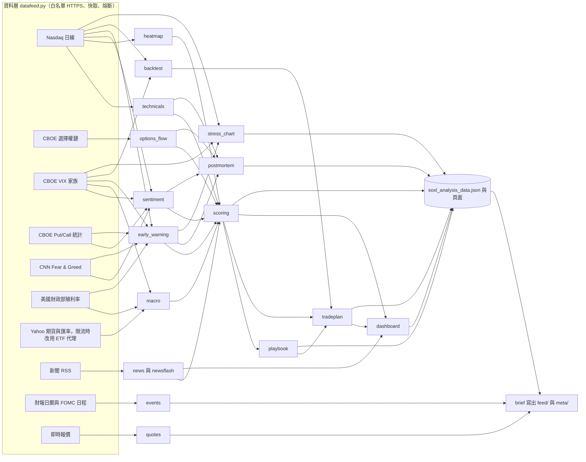

# SOXL 量化儀表板

每個美股交易日收盤後，這個 repo 重算 SOXL（Direxion Daily Semiconductor Bull 3X）的評級、交易計畫與崩跌風險。它寫出一張給人看的頁面，以及一份給 AI agent 的簡報。所有數字與判讀文字都由當天的資料算出，沒有寫死的日期或價位。程式只用 Python 標準函式庫。

## 頁面顯示什麼

打開 [index.html](index.html)。`soxl_analysis_report.html` 與 `soxl_simple.html` 是同一頁，舊網址都還能開。

第一屏不用捲動、不用點擊，就回答這七件事：

1. 評級，以及「現在該不該買」的白話答案。
2. 資料日期與資料狀態（官方日線、收盤即時報價補齊、盤中快照）。
3. 收盤價與一日漲跌。
4. 明天只盯的一個價位，以及它是買點觸發價還是停損價。
5. 崩跌指數（0 到 100）與分區。
6. VIX 讀數，以及最新一個交易日是不是 VIX 急升。
7. 組合圖。SOXL K 棒、VIX、成交量與均量、崩跌指數對齊同一條日期軸。

組合圖有日線（約 6 個月）與週線（約 2 年）兩個檢視。VIX 急升的 K 棒換色並加標籤。圖上另有趨勢通道、右側的成交量分布、十字線讀數。圖下方的「歷史佐證」列出過去 VIX 急升之後、崩跌指數升到 80 以上之後，SOXL 實際怎麼走。每個數字都附基準、樣本數、樣本期間。

再往下是十個區塊：今天怎麼做、為什麼是這個評級、價位與劇本、崩跌風險、情緒與波動與宏觀、期權與大戶、成分股與費半、新聞與時事、訊號驗證與評級紀錄、崩跌復盤與教訓。每個區塊先給一行由資料算出的結論，再給一個圖或一張短表。其餘依據收在摺疊裡，預設關閉。

## 重畫頁面

這個指令不連網。它用既有的 `soxl_analysis_data.json` 重畫頁面，並重建 `feed/` 與 `meta/`。

```bash
python3 generate_html_report.py --offline
```

## 文件地圖

| 文件 | 內容 |
|---|---|
| [AGENTS.md](AGENTS.md) | 給 AI agent 的說明：網址、欄位、解讀規則、MCP 工具、推播信封 |
| [PUBLISHING.md](PUBLISHING.md) | 從另一台電腦推送到 GitHub 的步驟，以及推送後自動發生的事 |
| [docs/section_log.md](docs/section_log.md) | 區塊紀錄：兩張舊頁面的每一塊現在在哪裡、移除了什麼、理由是什麼 |
| [docs/modules.md](docs/modules.md) | 每個分析模組的規則、頁面元素怎麼讀、輸出 JSON 的結構 |
| [docs/auto_update.md](docs/auto_update.md) | 每日排程、設定檔、推播頻道、發佈、疑難排解 |
| [docs/page_markers.md](docs/page_markers.md) | 給腳本用的頁面標記 |
| [docs/stress_chart_data.md](docs/stress_chart_data.md) | 組合圖資料的欄位與規則 |

## 快速開始

你需要 Python 3.12 以上。不用安裝任何套件，`requirements.txt` 是空的。下面的指令寫 `python3`。資料夾裡有 `.venv` 時，把 `python3` 換成 `.venv/bin/python`。

```bash
python3 analyze_soxl.py                      # 下載（快取 6 小時）、分析、寫出 JSON 與頁面，約 1 到 4 分鐘
python3 analyze_soxl.py --refresh            # 先清快取再下載
python3 analyze_soxl.py --no-html            # 只寫 JSON
python3 generate_html_report.py              # 不重算模型，重畫頁面與 feed/（會抓近期事件與即時報價）
python3 generate_html_report.py --offline    # 同上，完全不連網
SOXL_OFFLINE=1 python3 analyze_soxl.py       # 只用 .cache/ 裡的回應重算，不發任何請求
```

`SOXL_OFFLINE=1` 只凍結快取，不凍結時鐘。有些查詢用當天日期當鍵，隔天重放會查不到，該來源就照「抓取失敗」降級。

安裝每日自動更新：

```bash
python3 auto_update.py install      # 安裝 macOS 排程。預設週二到週六 07:30（台北），也就是美股週一到週五收盤後
python3 auto_update.py status       # 排程狀態、上次結果、下次時間、推播與發佈結果
python3 auto_update.py run          # 立刻更新一次：抓資料、重算、頁面、feed/、推播、git push
python3 auto_update.py uninstall    # 移除排程
```

排程的機制、設定檔、推播頻道與疑難排解在 [docs/auto_update.md](docs/auto_update.md)。

## 輸出檔案

| 檔案 | 說明 |
|---|---|
| `index.html`、`soxl_analysis_report.html`、`soxl_simple.html` | 同一張頁面的三個檔名。單一檔案，沒有外部資源，離線也能開。頁面每 30 分鐘自動重新載入 |
| `soxl_analysis_data.json` | 所有模組的結構化結果，約 770 KB。結構見 [docs/modules.md](docs/modules.md) |
| `feed/latest.md`、`feed/latest.json`、`feed/latest.txt` | 給 AI agent 的簡報：一頁式 Markdown、結構化 JSON（schema `soxl-quant-brief/2`）、手機短訊版 |
| `feed/rss.xml`、`feed/quotes.json`、`feed/schema.json`、`feed/index.json` | RSS、產生當下的報價快照、JSON Schema、歷史簡報目錄。每日歸檔 `feed/YYYY-MM-DD.json` 與 `feed/YYYY-MM-DD.md` 保留 120 天 |
| `meta/` | 給 AI agent 整包讀的資料夾。純 Markdown 加 JSON，每次更新重建 |
| `history/verdicts.jsonl` | 每個交易日一行的評級紀錄。之後自動回填 5 日與 10 日的實際報酬 |
| `history/snapshots/*.json.gz` | 每日完整 JSON 快照，保留 180 天。任一天的頁面都能用它重畫 |
| `logs/last_run.json`、`logs/auto_update.log` | 自動更新的最近結果與紀錄 |
| `.cache/` | 下載資料的快取。可以刪 |

## 資料怎麼流



`soxl_quant/pipeline.py` 控制執行順序。任何一個來源失敗，只有用到它的模組降級，其他分析照常。失敗原因寫進 JSON 的 `warnings`，頁面只顯示缺漏來源的名稱。`stress_chart` 只描述，不回頭影響任何評級、分數、價位或交易計畫。

最後一步除了寫出 JSON 與頁面，還做四件事：追加 `history/verdicts.jsonl` 的當日紀錄並回填舊紀錄的實際報酬、存 gzip 快照、把排程狀態放進頁面、抓近期事件與即時報價後產生 `feed/` 與 `meta/`。所有檔案都是原子寫入（先寫暫存檔再改名），排程中途失敗不會留下半份頁面。

## 資料來源、快取與安全

所有來源都免費，不需要 API 金鑰。

| 資料 | 來源與端點 | 歷史長度 | 用途 |
|---|---|---|---|
| SOXL、SOXX、SOXS、SPY、QQQ、HYG、TLT 與 16 檔成分股的日線 | `api.nasdaq.com/api/quote/{SYM}/historical` | 5 年，回測用 10 年 | 技術、廣度、事件研究、資金流、回測、組合圖 |
| 當日 K 線補齊 | `api.nasdaq.com/api/quote/{SYM}/chart` 的 1 分鐘序列，加上 `…/info` 的官方收盤與市場狀態 | 當日 | Nasdaq 官方日線要收盤後數小時才公布。排程在收盤後 1 到 3 小時跑時，用這兩個端點補上當天的 K 線，隔天自動換回官方日線 |
| 即時報價快照 | `api.nasdaq.com/api/quote/{SYM}/info`，加上 `cdn.cboe.com/api/global/delayed_quotes/quotes/_{IDX}.json`（延遲 15 分） | 當下 | `feed/quotes.json`、MCP `get_quotes`、`auto_update.py quotes` |
| SOXL、SOXX、SOXS 選擇權鏈 | `cdn.cboe.com/api/global/delayed_quotes/options/{SYM}.json` | 延遲報價 | 期權籌碼、GEX、大戶流、預期波動 |
| VIX、VIX9D、VIX3M、VIX6M、VIX1D、VVIX、SKEW | `cdn.cboe.com/api/global/us_indices/daily_prices/{NAME}_History.csv` | 完整歷史 | VIX 家族、期限結構、前兆訊號、宏觀相關、組合圖的 VIX 急升 |
| 全市場 Put/Call | `cdn.cboe.com/data/us/options/market_statistics/daily/{YYYY-MM-DD}_daily_options` | 近 60 日 | 情緒、前兆訊號 |
| CNN Fear & Greed | `production.dataviz.cnn.io/index/fearandgreed/graphdata` | 250 日 | 情緒、前兆訊號、同類情境 |
| 美國公債殖利率曲線 | `home.treasury.gov/...daily-treasury-rates.csv/{year}/all` | 3 到 4 年 | 宏觀、前兆訊號 |
| Brent、美元指數、黃金、銅、BTC、MOVE | Yahoo Finance v8 chart。限流時自動改用 ETF 代理 BNO、UUP、GLD、CPER、IBIT（Nasdaq） | 1 到 2 年 | 宏觀相關、跨資產溫度計 |
| 新聞 | Yahoo Finance search、Google News RSS、Nasdaq 個股 RSS、Seeking Alpha 個股 RSS、CNBC、MarketWatch、Fed 新聞稿 RSS | 近 2 週 | 利多與利空分類、今日時事 |
| 未來事件 | FOMC：`federalreserve.gov/monetarypolicy/fomccalendars.htm`。成分股財報：`api.nasdaq.com/api/calendar/earnings?date=`。選擇權到期與 NYSE 假日由程式推算 | 未來 14 天 | 簡報的近期事件、推播的風險提醒 |

快取與限流：

- 每個請求的結果以 JSON 存在 `.cache/`，鍵是來源加參數的 SHA-256。存活時間 6 小時，新聞 30 分鐘，CBOE 每日統計 7 天。
- 每個主機有最小請求間隔（Yahoo 2.2 秒、Nasdaq 0.9 秒）與指數退避重試。
- Yahoo 回 HTTP 429 兩次後，程式在 10 分鐘內直接跳過該主機，流程不會卡住。此時 Brent 等指標換成 ETF 代理，頁面會註明。
- 當日 K 線補齊只快取 10 分鐘，而且只在官方日線落後最近一個交易日時才呼叫。

安全：

- 所有外連限定在白名單主機（`datafeed.ALLOWED_HOSTS`）。符號與日期參數都經正規表達式驗證。
- 頁面裡每個插值都經 `html.escape()`。新聞連結只有 `http` 或 `https` 開頭才會變成連結。
- 頁面帶 `Content-Security-Policy`：`default-src 'none'`、`connect-src 'none'`、`base-uri 'none'`、`form-action 'none'`，script 只允許帶 nonce 的那一段。
- 頁面的 script 不用 `innerHTML`、`outerHTML`、`document.write`、`insertAdjacentHTML`。它只改文字、樣式、屬性與摺疊的開關。它在你的瀏覽器裡記住兩件事：你選的圖表檢視（`localStorage` 與網址的 `#view=`），以及你打開了哪些摺疊（`sessionStorage`）。
- `soxl_quant/scheduler.py` 只呼叫固定路徑的 `/bin/launchctl`、`/usr/bin/osascript`、`/usr/bin/open`。設定檔裡的時間、星期、label、音效名稱都先驗證。通知文字以 argv 傳給 AppleScript，不做字串拼接。

## 常見問題

**我只想知道買還是賣，看哪裡？**
看第一屏。評級旁邊的「現在該不該買」就是答案。答案先看交易計畫：今天有驗證過的買訊而且風報比達標，才是「可以買」。沒有買訊時才看評級。所以評級和答案可能不同。依據在「今天怎麼做」區塊。

**組合圖上換了顏色的 K 棒是什麼？**
那一天 VIX 急升。規則是 VIX 收盤不低於之前 60 個交易日收盤中位數的 1.4 倍，只用到當天為止的資料。規則印在圖下方的規則列，參數在 `soxl_quant/stress_chart.py`。這個標記只描述，不改變評級。

**「買進 61%、賣出 16%」這種比例是什麼？**
把評分表每一項的權重，依分數正負分成買進、觀望、賣出三堆。它回答「有多少比重的證據站在哪一邊」。綜合評分回答「平均有多強」。兩個都偏同一邊而且信心是「高」時最可靠。這張條圖在「為什麼是這個評級」的摺疊裡。

**綜合評分是負的，但 Fear & Greed 極度恐懼，該買還是該賣？**
看兩個子分數。趨勢面負、逆勢面正，是超賣反彈格局：反彈機率升高但趨勢仍空，只適合小部位短線。趨勢面負、逆勢面也不高，代表情緒還沒投降，繼續觀望。任何情況都用「重返多頭檢核表」決定要不要建立趨勢部位。

**崩跌指數 70 是什麼意思？**
目前的前兆症狀負荷高於歷史上 70% 的日子。60 以上是注意，80 以上是警戒。價已在 200 日線之下時，它只代表壓力仍在。它不是擇時器，分數很高也可能出現在噴出中段。實際的命中率與基準在「崩跌風險」區塊的摺疊，以及組合圖下方的歷史佐證。

**三個劇本的機率怎麼來的？**
不是主觀給的。程式挑出今天成立、最貼切的歷史情境，用那些樣本 10 日後漲 10% 以上與跌 10% 以上的比例，當作反彈與續跌的機率。「價位與劇本」區塊寫明用的是哪個情境與樣本數。

**期權預期波動 ±30% 代表會漲跌 30% 嗎？**
不是。它代表目前的隱含波動率認為，到月選到期時約有 68% 的機率落在 ±30% 之內。這是定價，不是預言。三倍 ETF 的隱含波動率本來就高。

**大戶淨方向 −0.3 是壞事嗎？**
負值代表大額新倉以買 Put、賣 Call 為主，也就是避險或看空。方向是用最後成交價、買賣價與當日價格變化推估的近似值。搭配 Put 牆位置與 IV 偏度一起看。

**VIX 不到 20，為什麼 SOXL 可以跌 40%？**
VIX 衡量 S&P 500 的隱含波動。單一板塊去槓桿時 SPY 可能幾乎不動。三倍板塊 ETF 要看板塊自己的指標：距 200 日線的乖離、成分股廣度、派發日、SKEW、HYG 信用。這是 2026 年 10 月那次崩跌的教訓之一。

**頁面寫「收盤即時報價補齊」或「盤中快照」是什麼意思？**
Nasdaq 的官方日線要收盤後數小時才公布。排程在收盤後 1 到 3 小時執行時，程式用 Nasdaq 的 1 分鐘序列與官方收盤報價補上當天的 K 線，這是「收盤即時報價補齊」。它可能與隔天公布的官方收盤差幾分錢，下次更新自動換回。在美股盤中手動執行時，最後一根 K 線是到當下為止的快照，這是「盤中快照」，收盤後的自動更新會重算。

**自動更新有跑嗎？**
執行 `python3 auto_update.py status`。它列出排程是否載入、上次結果、下次時間、資料是否需要更新。頁尾的更新狀態也會顯示。沒收到通知時，先看 `logs/auto_update.log`。

**為什麼 Brent 顯示 BNO？**
Yahoo 對這台機器限流時，程式改用 ETF 代理（BNO、UUP、GLD、CPER、IBIT）並在名稱註明。原油因子此時改用 20 日變化評分。限流解除後重跑會換回。

## 限制

- 前兆系統的權重是人工設定的，沒有做參數擬合。驗證樣本是 SOXL 2021 年以來約 1,000 個交易日、二十多次事件，統計上是小樣本。
- 歷史同類情境是重疊樣本，連續多日可能同時符合。CNN Fear & Greed 只有 1 年歷史，用到它的情境樣本很少。
- 組合圖的 VIX 急升標記、趨勢通道與歷史佐證只描述過去。歷史佐證裡樣本數少於 20 的數字會標示小樣本。
- 期權成交方向、GEX 的造市商方向假設、大戶門檻都是常用的近似，不是交易所的真實買賣方資料。
- 新聞分類用關鍵字規則，可能誤判反諷或複雜句型。它適合看方向與主題。
- 收盤後 1 到 3 小時內產生的頁面，最後一根 K 線是即時報價補齊的。VIX 家族與 CBOE 每日 Put/Call 統計要到美東晚間或隔日才更新，當天的這些欄位沿用前一交易日。
- 自動更新需要 Mac 開機（可以睡眠）。排程時間關機時，下次登入會補跑。
- 這個工具是量化研究用途，不是投資建議。三倍槓桿 ETF 有波動衰減與極端回撤的風險。

## 維護與客製化

| 想做什麼 | 改哪裡 |
|---|---|
| 調整前兆訊號的權重或門檻 | `soxl_quant/early_warning.py` 的 `WEIGHTS` 與 `compute_daily_signals()` |
| 調整評分表的權重或標準 | `soxl_quant/scoring.py` 各 `_f(...)` 的權重與條件 |
| 改五格評級門檻或買進、觀望、賣出權重比 | `soxl_quant/scoring.py` 的「Beginner-friendly aggregates」段 |
| 改市場脈搏的權重 | `soxl_quant/sentiment.py` 的 `market_pulse()` |
| 更新成分股與權重 | `soxl_quant/heatmap.py` 的 `CONSTITUENTS` |
| 增減宏觀資產或代理 | `soxl_quant/macro.py` 的 `CORE` 與 `EXTENDED`，`soxl_quant/datafeed.py` 的 `PROXY_FALLBACK` |
| 改大戶門檻 | `soxl_quant/options_flow.py` 的 `whale_flow()` |
| 改新聞關鍵字或查詢 | `soxl_quant/news.py` 的 `BULL_KW`、`BEAR_KW`、`QUERIES`、`GOOGLE_QUERIES` |
| 改今日時事的主題、類別詞表、影響分、旗標 | `soxl_quant/newsflash.py` 的 `GOOGLE_QUERIES`、`RSS_FEEDS`、`SA_SYMBOLS`、`CATEGORIES`、`WHY`、`CAUTIONS`。改完跑 `tools/test_newsflash.py` |
| 改六個儀表的燈號規則、加碼決策、等級門檻 | `soxl_quant/dashboard.py` 的 `gauge_*` 與 `GRADE_STEPS`。改完跑 `tools/test_dashboard.py` |
| 改檢核表項目、曝險上限、三問三答 | `soxl_quant/playbook.py` 的 `checks` 與 `beginner` 區塊 |
| 改 VIX 急升、趨勢通道、週線、成交量分布、歷史佐證的規則 | `soxl_quant/stress_chart.py` 開頭的常數。改完跑 `tools/test_stress_chart.py`，並更新 [docs/stress_chart_data.md](docs/stress_chart_data.md) |
| 改第一屏的讀數或版面 | `soxl_quant/report_page.py` 的 `first_screen()` 與 `PAGE_CSS` |
| 改組合圖的畫法 | `soxl_quant/report_chart.py`。改完跑 `tools/test_report_chart.py` |
| 改某個區塊的結論句、圖表或摺疊 | `soxl_quant/report_sections.py` 的 `_take_*()` 與 `_*_parts()`。改完跑 `tools/test_report_sections.py` |
| 改名詞小抄或共用樣式 | `soxl_quant/report_html.py` 的 `GLOSSARY` 與 `CSS` |
| 改完任何版面 | 跑 `tools/qa_render.py` 與 `tools/qa_stress.py`，兩個都要 0 issues。需要 Google Chrome |
| 改燈號投票規則或快照保留天數 | `soxl_quant/history.py` 的 `technical_lights()` 與 `SNAP_KEEP` |
| 換成別的標的（例如 TQQQ） | `soxl_quant/pipeline.py` 裡的 `"SOXL"`、`heatmap.CONSTITUENTS`、`sentiment.leveraged_flows()` 的 SOXS。其餘邏輯通用 |
| 改自動更新的時間、星期、重試、通知 | 編輯 `auto_update_config.json`，再執行 `auto_update.py install` |
| 不是 macOS | `scheduler.install()` 只支援 launchd。Linux 用 cron 執行 `auto_update.py run --if-stale`，Windows 用工作排程器執行同一個指令 |

## 檔案結構

```text
analyze_soxl.py              入口：下載、分析、寫出 JSON 與頁面
generate_html_report.py      用既有 JSON 重畫頁面並重建 feed/ 與 meta/
auto_update.py               每日自動更新，以及簡報、推播、發佈的指令
auto_update_config.json      排程設定（時間、星期、重試、通知、發佈、feed 網址）
notify_config.example.json   推播頻道範本。複製成 notify_config.json 再填金鑰，git 不追蹤它
soxl_mcp.py                  MCP server（stdio）：8 個工具、9 個資源、1 個提示範本
requirements.txt             空的，程式只用標準函式庫
AGENTS.md  PUBLISHING.md  README.md
index.html  soxl_analysis_report.html  soxl_simple.html   輸出：同一張頁面
soxl_analysis_data.json      輸出：結構化結果
feed/                        輸出：給 AI agent 的簡報
meta/                        輸出：給 AI agent 整包讀的資料夾
history/                     輸出：verdicts.jsonl 與 snapshots/
docs/
  section_log.md             區塊紀錄
  modules.md                 模組規則、頁面元素、JSON 結構
  auto_update.md             排程、推播、發佈
  page_markers.md            頁面標記
  stress_chart_data.md       組合圖資料
.github/workflows/
  deploy.yml                 push 到 main 後部署 GitHub Pages
  daily-update.yml           雲端更新：repo 內的資料落後時才跑一次並 commit
tools/
  qa_render.py               版面檢查：headless Chrome 在 9 種寬度量裁切、重疊、斷行、第一屏、十字線
  qa_stress.py               用極端假資料壓測版面
  qa_brief.py                簡報檢查：計畫不變量、數字可追溯、表格形狀、大小預算
  test_backtest.py           回測引擎
  test_dashboard.py          六個儀表
  test_newsflash.py          今日時事分類
  test_stress_chart.py       組合圖資料：急升規則、週線、歷史佐證
  test_report_chart.py       組合圖的畫法
  test_report_sections.py    十個區塊：結論、摺疊、缺漏說明、跳脫
  test_offline.py            SOXL_OFFLINE 離線重放
  test_agent_pack.py         給 agent 的操作包
  test_mcp.py                MCP server（會抓即時報價）
  test_push.py               推播（本機假 inbox）
tests/
  test_quote_labels.py       Nasdaq 報價的盤前與盤後標籤
soxl_quant/
  datafeed.py                資料層：白名單、快取、節流、熔斷、ETF 代理、當日 K 線補齊、離線重放
  indicators.py              純數學：均線、RSI、KDJ、MACD、ATR、ADX、Supertrend、布林、波段偵測
  technicals.py              技術分析與 11 列指標表
  options_flow.py            期權：P/C、GEX、Gamma 翻正、牆、Max Pain、大戶流、預期波動
  sentiment.py               Fear & Greed、VIX 家族、CBOE P/C、資金流、跨資產、市場脈搏
  heatmap.py                 成分股廣度與熱力圖
  macro.py                   跨資產相關與 Beta
  early_warning.py           崩跌指數：21 項前兆、百分位校準、事件研究、同類情境
  scoring.py                 7 個維度的評分表與格局判定
  playbook.py                結論、價位階梯、三個劇本、檢核表
  backtest.py                23 條固定規則的 10 年回測：勝率對基準、信賴區間、p 值、等級
  tradeplan.py               交易計畫：方向、進場觸發、停損、兩個目標、風報比、倉位
  postmortem.py              崩跌復盤與教訓
  news.py                    新聞抓取與多空分類
  newsflash.py               最近 36 小時的時事：類別、影響分、旗標
  dashboard.py               六個儀表、因子等級、四個聲音
  stress_chart.py            組合圖的資料：日線與週線、VIX 急升、趨勢通道、成交量分布、歷史佐證
  report_page.py             頁面：第一屏與組裝
  report_chart.py            頁面：組合圖與歷史佐證
  report_sections.py         頁面：十個區塊與頁尾
  report_html.py             頁面：共用零件（跳脫、SVG 小工具、名詞小抄、基礎樣式）
  brief.py                   簡報：latest.json、latest.md、latest.txt、RSS、schema、歸檔
  meta_pack.py               meta/ 資料夾
  agent_pack.py              給 AI agent 的操作包
  events.py                  未來事件：FOMC、財報、選擇權到期、休市
  quotes.py                  即時報價快照
  notify.py                  推播頻道
  publish.py                 git commit、rebase、push
  history.py                 每日評級紀錄、快照、實際報酬回填、價格燈號
  scheduler.py               launchd 排程、設定驗證、macOS 通知
  marketclock.py             美股交易日曆
  fsio.py                    原子寫檔
  pipeline.py                流程控制與 build_feed()
```

安裝排程後，系統另有兩個檔案不在這個資料夾裡：`~/Library/LaunchAgents/com.soxlquant.autoupdate.plist` 與 `~/Library/Logs/soxl_quant/` 下的 launchd 紀錄。

## AI agent 怎麼接

欄位表、新鮮度規則、轉述規則與推播信封都在 [AGENTS.md](AGENTS.md)。接法有三種：

- **抓網址。** 發佈到 GitHub Pages 之後，任何能上網的 agent 直接讀 `feed/latest.md` 或 `feed/latest.json`。公開網址的開頭由 `auto_update_config.json` 的 `feed.base_url` 決定。
- **MCP。** `python3 auto_update.py mcp-config` 印出設定片段。`soxl_mcp.py` 提供 `get_brief`、`get_latest`、`get_quotes`、`get_news`、`get_events`、`get_history`、`get_status`、`refresh`。
- **推播。** `python3 auto_update.py notify-config` 建立 `notify_config.json`。每次更新成功後，程式依設定推到 webhook、Google Chat、Slack、Discord、Telegram、LINE、email 或本機指令。頻道說明在 [docs/auto_update.md](docs/auto_update.md)。

`meta/` 是可以整個上傳給 agent 的資料夾。它的檔案地圖在 `meta/README.md`。

## 常用指令與檢查

```bash
python3 auto_update.py brief            # 印出最新簡報（--json 或 --text）
python3 auto_update.py quotes           # 即時報價（--json）
python3 auto_update.py feed             # 不重算模型，重建 feed/（含最新事件與報價）
python3 auto_update.py meta             # 重建 meta/
python3 auto_update.py config           # 看或建立排程設定檔
python3 auto_update.py push-status      # 檢查推播設定（金鑰已遮罩）
python3 auto_update.py push-test        # 對啟用的頻道送測試訊息
python3 auto_update.py push             # 把最新簡報再推一次
python3 auto_update.py publish          # 立刻 git commit 並 push 輸出檔
python3 auto_update.py mcp-install      # 把 MCP server 寫進 Antigravity 的設定
python3 auto_update.py pack-agent       # 產生給 AI agent 的操作包
python3 auto_update.py pack-repo        # 產生 repo 壓縮檔，帶去有 GitHub 權限的電腦推送
```

`auto_update.py` 另有 `notify-test`、`sidecar-install`、`sidecar-uninstall` 三個指令，說明在 [docs/auto_update.md](docs/auto_update.md)。

下面的檢查只有最後一個會連網。版面的兩個需要 Google Chrome：

```bash
python3 tools/test_backtest.py          # 回測引擎
python3 tools/test_dashboard.py         # 六個儀表
python3 tools/test_newsflash.py         # 今日時事分類
python3 tools/test_stress_chart.py      # 組合圖資料
python3 tools/test_report_chart.py      # 組合圖的畫法
python3 tools/test_report_sections.py   # 十個區塊
python3 tools/test_offline.py           # 離線重放開關
python3 tools/test_agent_pack.py        # 操作包產生器
python3 tools/test_push.py              # 推播（本機假 inbox）
python3 tests/test_quote_labels.py      # 報價標籤
python3 tools/qa_brief.py               # 簡報
python3 tools/qa_render.py              # 版面，需要 Google Chrome
python3 tools/qa_stress.py              # 版面壓測，需要 Google Chrome
python3 tools/test_mcp.py               # MCP server。這個會連網抓即時報價
```

`tools/qa_render.py` 另有 `--first-screen`、`--crosshair`、`--snapshots`、`--shot` 四個模式，用法寫在檔案開頭。
