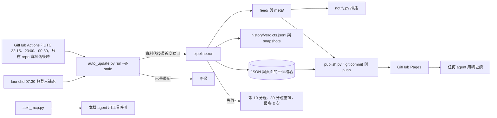

# 每日自動更新、推播與發佈

這份文件說明排程怎麼跑、設定檔每個欄位、推播頻道、發佈到 GitHub Pages 的做法，以及常見故障的處理。一次性的安裝指令在 [README](../README.md)。從另一台電腦推送的步驟在 [PUBLISHING.md](../PUBLISHING.md)。

## 流程

1. **launchd LaunchAgent**（使用者層級，不需 sudo）依 `auto_update_config.json` 的 `times × weekdays` 觸發；預設 `07:30` × 週二～週六（台北時間）＝美股週一～週五收盤後 3.5 小時（冬令時間 4.5 小時）。
2. 觸發的指令是 `auto_update.py run --if-stale`：先判斷**需不需要更新** — 沒有成功紀錄、或上次資料日期落後「最近一個已收盤的美股交易日」（以 America/New_York 計算，收盤 + 75 分鐘緩衝）、或上次是盤中快照 → 執行；若 3 小時內剛成功更新過則略過（避免登入補跑與排程重疊）。
3. 執行 `pipeline.run(refresh=True)`：第一次嘗試清快取確保抓到當日資料；失敗則等 10 分鐘、30 分鐘重試（共 3 次，重試時沿用快取）。同時間只允許一個實例（`logs/.auto_update.lock`）。
4. 成功後寫 `logs/last_run.json`，產生 `feed/`，依 `notify_config.json` 推播（macOS 通知 + 啟用的頻道），再 `git commit + push` 輸出檔（`publish.git_push`）；失敗 3 次則通知「自動更新失敗，沿用上一份報告」並推送 `soxl.update_failed` 事件（舊報告不會被破壞，因為所有輸出都是原子寫入）。
5. `RunAtLoad` + `--if-stale`：**登入 / 開機時**若發現資料落後就立刻補跑，所以排程時間 Mac 關機也不會漏掉一天；Mac 只是睡眠的話，launchd 會在喚醒時補跑錯過的排程（這是 launchd 相對 cron 的優點）。
6. **雲端更新**：`.github/workflows/daily-update.yml` 在 UTC 22:15 / 23:00 / 00:30（台北 06:15 / 07:00 / 08:30，週一～五收盤後）檢查 repo 內 `soxl_analysis_data.json` 的 `data_as_of` 是否落後最近交易日；落後才在 GitHub Actions 跑一次 `auto_update.py run --no-notify --no-publish` 並 commit（JSON、HTML、`feed/`、`meta/`、`history/`）。本機沒有 GitHub 推送權限時，這就是公開網址唯一的更新來源，Muse 等 agent 只需每天去同一組網址撈。Mac 正常運作時它永遠是「已是最新 → 略過」，所以不會互相覆蓋；Mac 端 `publish.py` 推送前會先 fetch + rebase，衝突時保留本機較新的產出檔。

## 為什麼收盤後 1–3 小時就能拿到當天收盤

Nasdaq 的歷史日線 API 通常要到當天晚間（美東 9–11 點之後）才會加入當日那一列。為了讓 07:30 的排程仍是「今天的」結果，`datafeed.fetch_history()` 在官方日線落後最近一個交易日時，會呼叫 `fetch_nasdaq_latest_session()`：用 `quote/{SYM}/chart` 的 1 分鐘序列取 09:30–16:00 ET 的開高低收與成交量，並以 `quote/{SYM}/info` 的官方收盤取代最後一筆成交。這根 K 線標記 `provisional=True`；頁面頂端的資料狀態會寫「收盤即時報價補齊」，隔天官方日線公布後自動替換。SOXL、SOXX、SPY、HYG 與 16 檔成分股都適用。

## 設定檔 `auto_update_config.json`

| 欄位 | 預設 | 說明 |
|---|---|---|
| `times` | `["07:30"]` | 本機時間 HH:MM，可多個（例如再加 `"23:30"` 取得美股盤中快照） |
| `weekdays` | `[2,3,4,5,6]` | launchd 星期：0=日 … 6=六 |
| `run_at_login_if_stale` | `true` | 登入 / 開機時資料落後就補跑 |
| `retries` / `retry_wait_min` | `3` / `[10, 30]` | 嘗試次數與每次重試前等待分鐘 |
| `refresh_cache` | `true` | 第一次嘗試清快取 |
| `notify` / `notify_sound` | `true` / `"Glass"` | 是否推播（macOS 通知 + `notify_config.json` 內啟用的頻道）與音效（空字串 = 靜音） |
| `open_after_update` | `false` | 成功後自動用瀏覽器開啟頁面 |
| `publish.git_push` / `remote` / `branch` | `true` / `"origin"` / `"main"` | 成功後自動 commit 輸出檔並 push（資料夾不是 git repo 或沒有遠端時自動略過） |
| `feed.base_url` | GitHub Pages 網址 | 用來組 `feed/latest.json` 等公開連結放進簡報與推播 |

改完設定後重新執行 `auto_update.py install` 讓 plist 生效。推播頻道設定在另一個檔 `notify_config.json`（見下面「推播頻道」）。

## 疑難排解

| 現象 | 處理 |
|---|---|
| `status` 顯示 `loaded: False` | 重新 `install`；若 `launchctl bootstrap` 報錯，看 `~/Library/Logs/soxl_quant/launchd.err.log` |
| `launchd.err.log` 出現 `Operation not permitted` / `PermissionError` 讀寫 Documents | macOS 隱私權限：系統設定 → 隱私權與安全性 → 檔案與檔案夾（或完整磁碟取用權）→ 允許 `python3.14`（Homebrew 的 `/opt/homebrew/Cellar/python@3.14/.../python3.14`）；或把專案移到非受保護資料夾 |
| 沒有收到通知 | `auto_update.py notify-test`；系統設定 → 通知 → 允許「指令碼編輯程式 / osascript」顯示通知 |
| 上次失敗（`logs/last_run.json` 的 `status: error`） | 多半是某個 API 暫時 429 / 逾時；手動 `auto_update.py run` 即可，報告會沿用最近一次成功版本 |
| `status` 的「發佈 git」顯示 `error … Permission denied (publickey)` | 這台 Mac 的 SSH 金鑰還沒加到 GitHub：`pbcopy < ~/.ssh/id_ed25519.pub` 後貼到 GitHub → Settings → SSH and GPG keys；或 `publish.git_push=false` 關閉 |
| 推播某頻道 ❌ | `auto_update.py push-test --only <type>` 看詳細錯誤；`push-status` 檢查設定（金鑰已遮罩） |
| 想暫停 | `auto_update.py uninstall`（移除 plist）；要恢復再 `install` |

## 發佈到 GitHub Pages

`publish.py` 在每次成功更新後：`git add`（只加輸出檔：JSON、3 個 HTML、`feed/`、`meta/`、`history/`）→ `commit`（訊息 `data: <日期> close $<價> <評級> composite <分> [auto]`，作者 `soxl-quant-bot`）→ `fetch` + `rebase`（衝突時保留本機產出）→ `push`。全程 `GIT_TERMINAL_PROMPT=0`、`ssh -o BatchMode=yes`，絕不卡在密碼提示、絕不 force push。push 成功後 `deploy.yml` 自動部署 Pages。

## 推播頻道

`notify_config.json`（`auto_update.py notify-config` 建立，`chmod 600`，git 不追蹤；任何值可寫 `"$ENV:NAME"` 從環境變數讀）定義頻道；`run` 成功後依 `send_on` 政策（`success` / `failure` / `only_if_verdict_changed`）逐一送出，結果寫進 `logs/last_run.json["push"]` 並顯示在 `status`。

| 頻道 | 說明 |
|---|---|
| `webhook` | 任何 HTTPS 端點（本機 `127.0.0.1` 可用 http）。`format=json` 送完整信封（含 `brief`）、`slim` 不含 `brief`、`text` 送 Markdown 本文；可加 `bearer_token`、自訂 `headers`、`hmac_secret`（`X-SOXL-Signature: sha256=<hex>`，對 body 算 HMAC-SHA256）。**這就是給 Muse 的入口**：把 Muse 的 inbox URL 填進去即可 |
| `google_chat` / `slack` / `discord` | incoming webhook；主機名固定允許清單 |
| `telegram` | Bot API `sendMessage`（HTML 模式） |
| `line` | LINE Messaging API push（channel access token + 使用者 / 群組 ID） |
| `email` | SMTP（STARTTLS 或 SSL），本文是 Markdown 簡報，可附頁面 HTML |
| `agentapi` | Antigravity / Jetski 的 `agentapi new-conversation`（開一個新對話，把簡報與「請吸收並用三句話回答」的前言一起丟進去）或 `send-message` 到指定對話 ID。**只在 agent 環境內可用**（需要 `ANTIGRAVITY_LS_ADDRESS`），排程推播請用下面的 sidecar |
| `command` | 本機任意執行檔（argv 陣列、不經 shell；`{title}` `{text}` `{markdown}` `{json_path}` `{md_path}` `{html_path}` 會被代入），stdin 收到 JSON 信封 — 任何有 CLI 的 agent 都能接 |
| `macos` | 通知中心 |

安全：各頻道主機名固定（generic webhook 僅限 HTTPS 或本機），secrets 不進 log / feed / git，`push-status` 顯示時會遮罩；所有子程序都是 argv 陣列。驗證：`tools/test_push.py` 會起一個本機假 inbox 檢查格式、簽章、允許清單與政策。

每個頻道要填哪些欄位、webhook 信封的格式，見 [AGENTS.md](../AGENTS.md) 第 1 節 C。

## Antigravity sidecar

Muse 就是 Antigravity agent 時：`auto_update.py sidecar-install` 會寫 `~/.gemini/config/sidecars/soxl-daily-brief/sidecar.json`（`builtin: schedule` → `agentapi new-conversation`，預設週二～六 07:50）。每個交易日早上 Antigravity 自動開一個「SOXL 每日簡報」對話，agent 讀 `feed/latest.md`、確認新鮮度，然後用三句話回報該買 / 該賣 / 觀望與要盯的價位。`sidecar-uninstall` 移除。
